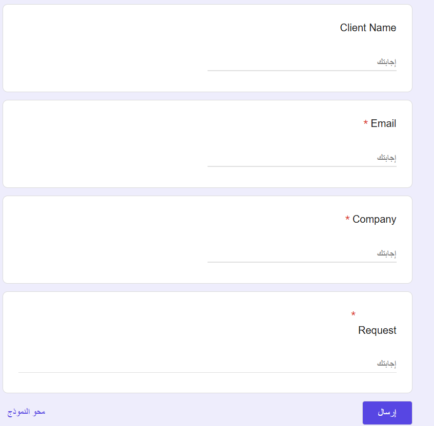
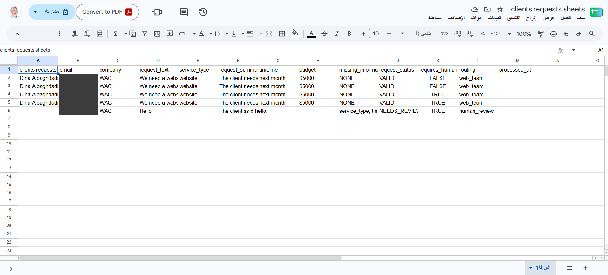

# AI Client Intake & Request Routing System

> A Zapier automation that reads free-text client requests from a Google Form, extracts the key details with AI, and routes each request either to the web team or to human review — then records it in a sheet and sends the right email.

**🌐 English** · [العربية](#-النسخة-العربية)

---

## 🎯 Problem

### The Context

A services company (websites, digital marketing, apps) receives requests from potential clients through an online form. Every client writes in their own way: some explain everything, others send a short message or forget important details.

### The Problem

An employee has to read each request, understand what the client needs, organize the information, check whether it is complete, and decide the next step. As requests grow, this manual work becomes repetitive, slows down follow-up, and important details can be lost.

### Why It Matters

Complete requests should reach the responsible team quickly, while incomplete or unclear ones must not be lost — they need a human to follow up with the client.

---

## 💡 Solution

A Zapier automation connected to a Google Form, a Google Sheet, and Gmail.

What does the system do?

1. Captures each new client request from a **Google Form**.
2. Uses **AI by Zapier** to extract: service type, timeline, budget, summary, and missing information.
3. Returns a clear signal: `request_status` = `VALID` or `NEEDS_REVIEW`.
4. Routes the request with **Paths by Zapier**: `VALID` → web team, anything else → human review (**Fallback**).
5. Records the request and the result in **Google Sheets** and sends the matching **Gmail** notification.



---

## 👤 Users

**Primary Users:**  
Potential clients who submit a request, and the company team (web team / reviewer) who receives it.

**User Need:**  
Clients need a simple form to describe what they want. The team needs each request already organized and clearly marked as ready to work on or needing follow-up.

---

## 🧠 How I Designed the Solution

We did not start with the tool. We followed **Understand → Design → Build → Test → Refine**: business analysis, workflow decomposition, data design, and decision & exception design came before building the Zap.

The design follows one mental model:

```text
AI                  → Understand  (extract information from free text)
Automation / Logic  → Control     (route by a clear status)
Human               → Judge       (handle incomplete or unclear requests)
```

---

## ⚙️ How It Works

```text
Google Form — New Form Response (trigger)
  ↓
AI by Zapier — extract service_type, timeline, budget, summary, missing_information → request_status
  ↓
Paths by Zapier
  ├─ valid:    request_status = VALID  → Create Spreadsheet Row (false / web_team)    → Gmail: New Valid Client Request
  └─ Fallback: anything else            → Create Spreadsheet Row (true / human_review) → Gmail: Client Request Requires Human Review
```


---

## 🤖 Role of AI

What does AI do in this solution?

- Extracts **service_type**, **timeline**, and **budget** only when the client states them explicitly.
- Writes a short **request_summary** of what the client asked for.
- Lists **missing_information** (`service_type`, `timeline`, `budget`, or `NONE`).
- Returns **request_status**: `VALID` only if all three required fields are present and valid.

<details>
<summary><b>AI prompt</b></summary>

```text
Analyze the client request and extract structured information.

Use ONLY information explicitly provided by the client. Never invent, assume, infer, estimate, or guess.

Required information: service_type, timeline, budget

service_type: the explicitly requested service ("We need a website" → website). If not provided → null.
timeline: a specific timeframe exactly as stated ("next month", "in 3 weeks", "by December").
  Vague expressions ("soon", "as soon as possible", "urgently") → null.
budget: only when explicitly provided ("$5000"). Never estimate. If not provided → null.
request_summary: summarize only what the client explicitly requested.
missing_information: required fields that are missing or ambiguous (service_type, timeline, budget),
  comma-separated. If nothing is missing → NONE.

request_status: VALID only if service_type, timeline, and budget are all explicitly provided and valid.
  Otherwise NEEDS_REVIEW.
routing: VALID → web_team, NEEDS_REVIEW → human_review.
```

</details>

### What AI Should NOT Do

- Invent, estimate, or guess missing details (for example, a budget).
- Turn a vague timeframe like *"soon"* into a specific date.
- Control the process alone: the path decision, `requires_human`, and the email are handled by the automation, and unclear cases go to a human.

---

## 🔄 Automation

What parts of the process are automated?

- Detecting each new form response.
- Extracting and organizing the request details (AI).
- Routing to the correct path, with a **Fallback** path so no request is lost.
- Recording each request with its result in Google Sheets.
- Notifying the web team or the reviewer by email.

---

## 🗂️ Data

### Input

A Google Form with: **Client Name**, **Email** (required), **Company** (required), and **Request** (required, free text).

### Output

A row in the **clients requests** sheet with: `client_name`, `email`, `company`, `request_text`, `service_type`, `request_summary`, `timeline`, `budget`, `missing_information`, `request_status`, `requires_human`, `routing`, plus one email:

| Path | Sheet values | Email |
|---|---|---|
| valid | `VALID` / `false` / `web_team` | **New Valid Client Request** |
| Fallback | `NEEDS_REVIEW` / `true` / `human_review` | **Client Request Requires Human Review** |

---

## 🛠️ Tools & Technologies

| Tool | Purpose |
|---|---|
| Google Forms | Client request form |
| AI by Zapier | Extract structured information from free text |
| Paths by Zapier | Route by `request_status`, with a Fallback path |
| Google Sheets | Record every request and its result |
| Gmail | Notify the web team or the reviewer |

---

## 🔑 Key Design Decisions

### Decision 1

**Decision:**  
Use a single, clear signal — `request_status` — for routing.

**Why:**  
Instead of making the path interpret `budget = null`, `timeline = null`, and `missing_information`, it checks one value: `VALID` or not. This keeps the decision logic simple, clear, and easy to test and debug.

### Decision 2

**Decision:**  
Use **Paths** with a **Fallback**, not **Filter by Zapier**.

**Why:**  
A Filter stops the request. The goal is not to *stop* the exception but to *route* it: anything that is not exactly `VALID` goes to human review, so no request disappears.

### Decision 3

**Decision:**  
Set `requires_human` and `routing` as fixed values inside each path.

**Why:**  
Each path has its own clear outcome (`false` / `web_team` or `true` / `human_review`), so the sheet always shows what happened to the request.

---

## 🧪 Testing

### Test 1 — Complete request

**Input:**  
`We need a website for our company. Our budget is $5000. We need it next month.`

**Expected Result:**  
`service_type = website`, `timeline = next month`, `budget = $5000`, `missing_information = NONE`, `request_status = VALID` → **valid** path → `false` / `web_team` → email *New Valid Client Request*.

**Actual Result:**  
`website` / `next month` / `$5000` / `NONE` / `VALID` / `FALSE` / `web_team` (row 2).

**Status:** ✅

---

### Test 2 — Request with no details

**Input:**  
`Hello`

**Expected Result:**  
No service, timeline, or budget → `NEEDS_REVIEW` → **Fallback** path → `true` / `human_review`.

**Actual Result:**  
`request_summary = The client said hello.`, `missing_information = service_type, timeline, budget`, `NEEDS_REVIEW` / `TRUE` / `human_review` (row 6).

**Status:** ✅



> **Note on rows 3–5:** these are repeated runs of Test 1 while building and testing the Zap steps. Rows 4–5 show `VALID` with `requires_human = TRUE` — most likely from testing the **Fallback** sheet step with the Test 1 sample data, not from real routing, so they are not counted as results.

---

## 📸 Evidence

### Final Result


### Workflow


---

## ⚠️ Challenges & Failures

What didn't work as expected?

- Testing a step inside a path (for example, the Fallback sheet step) writes a row using the sample data, even if that sample would never take that path — this produced rows that look inconsistent (`VALID` + `requires_human = TRUE`).
- The `processed_at` column stayed empty because it was not mapped in the sheet step.
- *"Hello"* was accepted by the form because the **Request** field only checks that something was typed.

How did I solve it?

- Identified test-step rows by comparing each row with the path it should belong to, and documented them instead of counting them as results.
- Kept the routing decision on one value (`request_status`) so every real run could be checked against the expected path.
- Recorded `processed_at` and stricter form validation as improvements.

---

## 📚 What I Learned

### Technical Lesson

How to connect Google Forms → AI by Zapier → Paths → Google Sheets → Gmail, and why a **Fallback** path is safer than a Filter.

### Problem-Solving Lesson

Think first, build later: understanding the work, the data, and the decisions before opening Zapier made the Zap simple and testable.

### AI Lesson

**AI → Understand, Logic → Control, Human → Judge.** AI is very good at turning free text into structured data, but it must not guess missing information, and unclear requests should reach a human instead of passing automatically.

---

## 🔮 Future Improvements

If I continued developing this project, I would:

- Map `processed_at` to record when each request was handled.
- Make **Client Name** required and add a minimum length to the **Request** field.
- Send the client an automatic email asking for the missing information.
- Route valid requests to different teams by `service_type` (web, marketing, apps).

---

## 🔗 Project Links

**Live Demo:** [Google Form — submit a client request](https://docs.google.com/forms/d/e/1FAIpQLScMBea-u6KARp9If3dFsyyBUCYGpS1NsrbSPNvVJL195kiLFA/viewform)

**Workflow:** [Zap — Clients Requests](https://zapier.com/editor/383094964/draft) _(private Zapier workspace — the full workflow is shown in the screenshot above)_

**Repository:** [AI Client Intake & Request Routing System](https://github.com/Dina-Albaghdadi/AI-Automation-Student-Portfolio-Template/tree/main/01-Process%20%26%20Data%20Thinking/Course-Project)

---

## 👩‍💻 Author

**Dina Albaghdadi**

[LinkedIn](https://www.linkedin.com/in/dina-albaghdadi-79bb9a25a/) · [GitHub](https://github.com/Dina-Albaghdadi)

---
---

<div dir="rtl">

## 🌍 النسخة العربية

> نظام أتمتة في Zapier يقرأ طلبات العملاء المكتوبة بنص حر من Google Form، ويستخرج تفاصيلها بالذكاء الاصطناعي، ثم يوجّه كل طلب إلى فريق المواقع أو إلى مراجعة بشرية، ويسجّله في شيت ويرسل البريد المناسب.

> الصور موجودة في النسخة الإنجليزية أعلاه.

### 🎯 المشكلة

**السياق:** شركة خدمات (مواقع، وتسويق رقمي، وتطبيقات) تستقبل طلبات العملاء المحتملين عبر نموذج إلكتروني، وكل عميل يكتب بطريقته: بعضهم يشرح كل شيء، وبعضهم يرسل رسالة قصيرة أو ينسى معلومات مهمة.

**المشكلة:** يحتاج موظف لقراءة كل طلب وفهمه وتنظيمه والتحقق من اكتماله وتحديد الخطوة التالية. ومع زيادة الطلبات يصبح هذا العمل متكررًا ويؤخر المتابعة وقد تضيع تفاصيل مهمة.

**لماذا يهم:** الطلبات المكتملة يجب أن تصل للفريق بسرعة، والطلبات الناقصة يجب ألا تضيع، بل تصل لإنسان يتابع مع العميل.

### 💡 الحل

1. يلتقط كل طلب جديد من **Google Form**.
2. يستخدم **AI by Zapier** لاستخراج: نوع الخدمة، والمدة الزمنية، والميزانية، والملخص، والمعلومات الناقصة.
3. يُرجع إشارة واضحة: `request_status` = `VALID` أو `NEEDS_REVIEW`.
4. يوجّه الطلب عبر **Paths**: `VALID` إلى فريق المواقع، وأي حالة أخرى إلى المراجعة البشرية (**Fallback**).
5. يسجّل الطلب ونتيجته في **Google Sheets** ويرسل بريد **Gmail** المناسب.

### 👤 المستخدمون

**المستخدمون:** العملاء الذين يرسلون الطلبات، وفريق الشركة (فريق المواقع أو المراجِع) الذي يستقبلها.

**الاحتياج:** العميل يحتاج نموذجًا بسيطًا، والفريق يحتاج كل طلب منظمًا ومعلّمًا بوضوح: جاهز للعمل أو يحتاج متابعة.

### 🧠 كيف صممنا الحل

لم نبدأ بالأداة، بل اتبعنا **Understand → Design → Build → Test → Refine**، وطبقنا النموذج الذهني:
**AI يفهم، والأتمتة تتحكم، والإنسان يحكم.**

### 🤖 دور الذكاء الاصطناعي

**ماذا يفعل:** يستخرج نوع الخدمة والمدة والميزانية فقط إذا ذكرها العميل صراحة، ويكتب ملخصًا، ويحدد المعلومات الناقصة، ويُرجع `request_status`.

**ما لا يفعله:** لا يخترع ولا يقدّر معلومات ناقصة (مثل الميزانية)، ولا يحوّل مدة غامضة مثل *"قريبًا"* إلى تاريخ محدد، ولا يتحكم بالعملية وحده.

### 🔄 الأتمتة

اكتشاف كل رد جديد، واستخراج التفاصيل، والتوجيه مع مسار **Fallback** حتى لا يضيع أي طلب، وتسجيل الطلب ونتيجته في الشيت، وإرسال البريد للفريق أو للمراجِع.

### 🔑 قرارات التصميم

1. **إشارة واحدة واضحة (`request_status`)** للتوجيه بدل أن يفسّر المسار عدة حقول، فيصبح القرار أبسط وأسهل في الاختبار.
2. **Paths مع Fallback بدل Filter:** الفلتر يوقف الطلب، والهدف هو *توجيه* الاستثناء وليس إيقافه.
3. **قيم ثابتة داخل كل مسار** (`requires_human` و`routing`) حتى يوضح الشيت دائمًا ماذا حدث للطلب.

### 🧪 الاختبارات

- **طلب مكتمل** (موقع، الشهر القادم، 5000$): `VALID` → فريق المواقع ✅
- **طلب بدون تفاصيل** (`Hello`): كل الحقول ناقصة → `NEEDS_REVIEW` → مراجعة بشرية ✅
- **ملاحظة:** الصفوف 3–5 تكرار لتجربة الطلب المكتمل أثناء البناء، والصفان 4–5 ناتجان على الأغلب عن اختبار خطوة الشيت في مسار Fallback ببيانات العينة، فلا يُحسبان كنتائج.

### ⚠️ التحديات وكيف حللتها

- اختبار خطوة داخل مسار يكتب صفًا ببيانات العينة حتى لو لم تكن تنتمي لهذا المسار، فظهرت صفوف تبدو غير متسقة. حددتها بمقارنة كل صف بالمسار المتوقع ووثّقتها بدل احتسابها.
- عمود `processed_at` بقي فارغًا لأنه لم يُربط في خطوة الشيت، وسجلته كتحسين.
- النموذج قبل كلمة *"Hello"* لأن حقل الطلب يتحقق فقط من وجود نص، وسجلت التحقق الأقوى كتحسين.

### 📚 ماذا تعلمت

- **تقنيًا:** ربط Google Forms ثم AI ثم Paths ثم Google Sheets ثم Gmail، ولماذا مسار Fallback أكثر أمانًا من الفلتر.
- **حل المشكلات:** فكّر أولًا ثم ابنِ؛ فهم العمل والبيانات والقرارات قبل فتح Zapier جعل الـZap بسيطًا وقابلًا للاختبار.
- **الذكاء الاصطناعي:** AI ممتاز في تحويل النص الحر إلى بيانات منظمة، لكن يجب ألا يخمّن المعلومات الناقصة، والطلبات غير الواضحة يجب أن تصل لإنسان.

### 🔮 تحسينات مستقبلية

ربط `processed_at`، وجعل اسم العميل إجباريًا مع حد أدنى لطول الطلب، وإرسال بريد تلقائي للعميل يطلب المعلومات الناقصة، وتوجيه الطلبات الصالحة لفرق مختلفة حسب نوع الخدمة.

</div>
