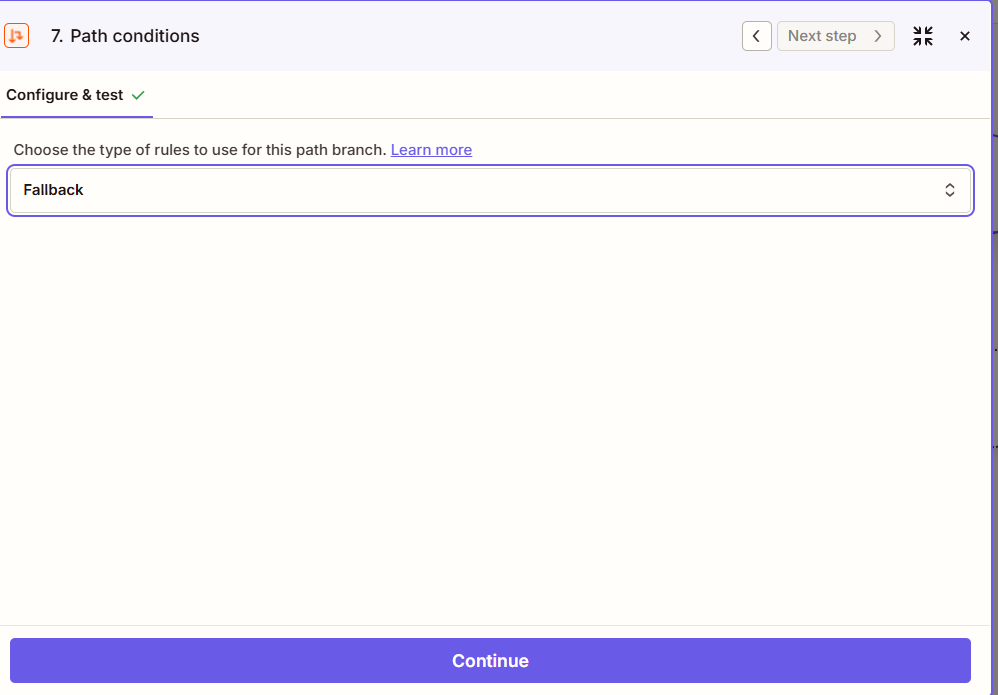
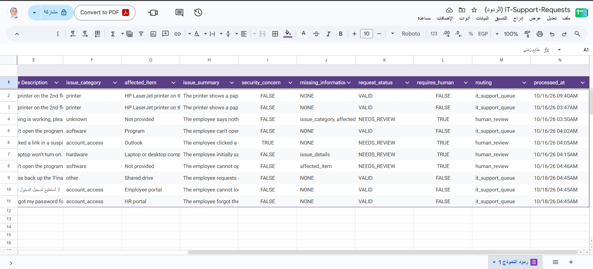
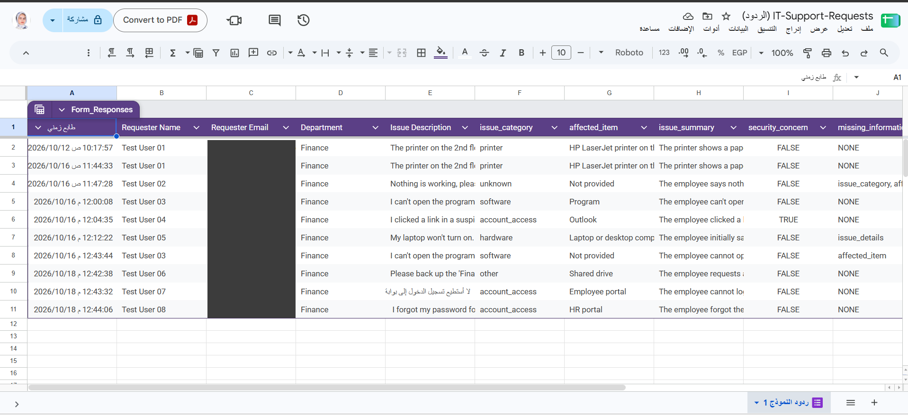

# IT Support Requests — AI Intake & Routing

> An automation that reads free-text IT support requests, extracts the key details with AI, and routes each request either to the IT support queue or to human review — then records the result and sends the right email.

**🌐 English** · [العربية](#-النسخة-العربية)

---

## 🎯 Problem

### The Context

Employees report IT problems by writing a short free-text description: a printer that won't print, a login error, a suspicious email. Someone from IT has to read every request, understand it, and decide what to do next.

### The Problem

Requests arrive in very different quality. Some are clear; others are vague (*"Nothing is working"*), miss the affected device, contradict themselves, or hide a security incident (*"I clicked a link and entered my password"*). Reading and sorting them manually is slow, and a risky request can be treated like a normal one.

### Why It Matters

Clear requests should reach the support team immediately, while unclear or risky ones must not slip through unnoticed. Separating the two saves time and reduces the chance of missing a security incident.

---

## 💡 Solution

A Zapier automation connected to a Google Form and a Google Sheet.

What does the system do?

1. Captures each new request from a **Google Form** (stored in **Google Sheets**).
2. Uses **AI by Zapier** to extract structured fields from the free text (Arabic or English).
3. Decides the request status: `VALID` or `NEEDS_REVIEW`.
4. Routes it with **Paths by Zapier**: `VALID` → IT support queue, anything else → human review.
5. Updates **the same row** in the sheet and sends the matching **Gmail** notification.


---

## 👤 Users

**Primary Users:**  
Employees who submit IT requests, and the IT support team / reviewer who receives them.

**User Need:**  
Employees need a simple way to report a problem. The IT team needs every request already organized, clearly marked as ready or needing review, with security concerns flagged.

---

## 🧠 How I Designed the Solution

I followed the lecture method: **Understand → Design → Build → Test → Refine**. Before opening Zapier, I wrote five design documents:

| Document | What it covers |
|---|---|
| [01 — Business Analysis](./docs/01-business-analysis.md) | Problem, scope, current process, success criteria |
| [02 — Workflow Decomposition](./docs/02-workflow-decomposition.md) | Tasks, order, Happy Path and Exception Path |
| [03 — Data Design](./docs/03-data-design.md) | Inputs, AI outputs, allowed values, sheet columns |
| [04 — Decision & Exception Design](./docs/04-decision-and-exception-design.md) | Rules, business exceptions vs technical failures, debugging |
| [05 — Automation Design](./docs/05-automation-design.md) | The full Zap, step by step, before building it |

Key principle: **anything uncertain goes to a human; nothing uncertain reaches the support team.**

---

## ⚙️ How It Works

```text
Google Form (employee request)
  ↓
Google Sheets — New Spreadsheet Row (trigger)
  ↓
AI by Zapier — extract fields + apply written rules → request_status
  ↓
Paths by Zapier
  ├─ Path A: request_status = VALID  → Update Row (VALID / it_support_queue)    → Gmail: Ready for Follow-up
  └─ Path B: Fallback (anything else) → Update Row (NEEDS_REVIEW / human_review) → Gmail: Requires Human Review
  ↓
Output: same row updated + email sent
```


---

## 🤖 Role of AI

What does AI do in this solution?

- Classifies the issue: `hardware`, `software`, `network`, `account_access`, `email`, `printer`, `other`, or `unknown`.
- Extracts the affected item (device / system / service) and writes a short English summary — even when the request is in Arabic.
- Flags security concerns (phishing, shared password, malware, lost device).
- Lists missing information, and returns `request_status` by applying rules written explicitly in the prompt.


<details>
<summary><b>AI prompt (final version)</b></summary>

```text
You extract structured information from an IT support request written by an employee.
The request may be written in Arabic or English.

Use ONLY information explicitly stated in the request.
Never invent, assume, or guess details (device brand, model, location, error message, or cause).
Do not diagnose the problem and do not suggest a solution.
Do not decide how the request should be routed.

Return exactly these fields:

issue_category
Exactly one of: hardware, software, network, account_access, email, printer, other, unknown
- hardware: physical devices (computer, laptop, monitor, keyboard, mouse, etc.), except printers
- software: applications or programs that do not work or need installation, except email
- network: internet, Wi-Fi, VPN, or network connection
- account_access: login, password, locked account, or permissions
- email: email services (Outlook, Gmail, etc.). Email password or login problems are account_access.
- printer: printers and scanners
- other: a clear technical request that fits none of the categories above
- unknown: the problem cannot be identified from the text

affected_item
The specific device, system, application, or service that is affected, as stated in the request,
as a short English phrase.
A generic word without a name (for example: the program, an app, the system, a website)
is NOT specific enough: return exactly: Not provided
A device type alone is enough (for example: laptop, printer, monitor).
If none is mentioned, return exactly: Not provided

issue_summary
One or two short English sentences summarizing only what the employee stated.

security_concern
Exactly true or false, in lowercase.
Return true only if the request explicitly mentions: clicking a suspicious link or attachment,
phishing, sharing a password or verification code, a hacked or compromised account,
unauthorized access, a virus, malware or ransomware, a lost or stolen device, or a data leak.
A forgotten password or a locked account alone is false.

missing_information
A comma-separated list using only these values: issue_category, affected_item, issue_details
- issue_category: the type of problem cannot be identified
- affected_item: no device, system, application, or service is mentioned
- issue_details: the description is too vague or contradictory to understand what happened
If issue_category is unknown, include issue_category.
If affected_item is Not provided, include affected_item.
If nothing is missing, return exactly: NONE

request_status
Exactly VALID or NEEDS_REVIEW, in uppercase.
Return VALID only if ALL of the following are true:
- issue_category is not unknown
- affected_item is not Not provided
- missing_information is exactly NONE
- security_concern is exactly false
Otherwise return NEEDS_REVIEW.
Decide request_status only from the fields above, after filling them.

Return only the values. No extra words, no quotes, no explanations.
```

</details>

### What AI Should NOT Do

- Invent details that are not in the request (brand, location, error message).
- Diagnose the problem or suggest a fix.
- Decide the routing destination or the `requires_human` flag — these are fixed values set by Zapier in each path.
- Judge whether a security incident really happened — it only flags that one was *mentioned*; a human decides.

---

## 🔄 Automation

What parts of the process are automated?

- Detecting each new request (Google Sheets trigger).
- Extracting and structuring the request details (AI).
- Routing to the correct path (Paths by Zapier, with a **Fallback** path so no request is lost).
- Writing the results into **the same row** (`Update Spreadsheet Row` by Row ID — no duplicate rows).
- Sending the right email to the support team or the reviewer.



---

## 🗂️ Data

### Input

A Google Form with four required questions: **Requester Name**, **Requester Email** (validated format), **Department**, **Issue Description** (free text, Arabic or English).

### Output

Nine result columns written to the same sheet row:

| Column | Example |
|---|---|
| `issue_category` | `printer` |
| `affected_item` | `HP LaserJet printer on the 2nd floor` |
| `issue_summary` | Short English summary |
| `security_concern` | `false` |
| `missing_information` | `NONE` |
| `request_status` | `VALID` / `NEEDS_REVIEW` |
| `requires_human` | `false` / `true` |
| `routing` | `it_support_queue` / `human_review` |
| `processed_at` | Run date and time |

Plus one email: **New IT Support Request — Ready for Follow-up** or **IT Support Request Requires Human Review**.

---

## 🛠️ Tools & Technologies

| Tool | Purpose |
|---|---|
| Google Forms | Employee request form with required fields |
| Google Sheets | One record per request, updated with the results |
| Zapier | Automation engine |
| AI by Zapier | Understands free text (Arabic / English) and extracts fields |
| Paths by Zapier | Routes to the support queue or human review (with Fallback) |
| Gmail | Notifications |

---

## 🔑 Key Design Decisions

### Decision 1

**Decision:**  
Update **the same row** (trigger: *New Spreadsheet Row*, action: *Update Spreadsheet Row* by Row ID) instead of creating a new row.

**Why:**  
One record per request keeps tracking simple. Using *New or Updated Spreadsheet Row* — or creating a row in the same sheet — would re-trigger the Zap and cause a loop.

### Decision 2

**Decision:**  
AI returns `request_status` by applying rules written explicitly in the prompt; Path A checks one rule (`request_status` exactly matches `VALID`), and Path B is a **Fallback**.

**Why:**  
This follows the lecture method and keeps routing simple. Because Path B catches *anything* that is not exactly `VALID` (including empty or unexpected values), no request can fall between the paths. Trade-off: the decision depends on the AI following the rules, so every test checks that `request_status` is consistent with the four fields.

### Decision 3

**Decision:**  
A security concern always goes to human review, even when the request is complete.

**Why:**  
A phishing click or a shared password is a possible incident, not a normal ticket. The reviewer email states `Security Concern: true` and asks to handle it as a security incident.

---

## 🧪 Testing

All test requests were submitted **from the form** after the Zap was published. Each case was checked at four layers: AI output → path → sheet row → email.

| # | Scenario | Expected | Actual | Status |
|---|---|---|---|---|
| TC01 | Complete printer request | `VALID` | `VALID` → it_support_queue | ✅ |
| TC02 | *"Nothing is working, please help."* | `NEEDS_REVIEW` | `unknown` / `Not provided` → human_review | ✅ |
| TC03 | *"I can't open the program I need for my work."* | `NEEDS_REVIEW` | 1st run: `VALID` ❌ → after prompt fix: `NEEDS_REVIEW` | ✅ after fix |
| TC04 | Clicked a suspicious link, entered Outlook password | `NEEDS_REVIEW`, security = true | security = `TRUE` → human_review | ✅ |
| TC05 | Login problem written **in Arabic** | `VALID` | `account_access` / `Employee portal` → it_support_queue | ✅ |
| TC06 | Back up the *Finance Reports* folder | `VALID`, category `other` | `other` / `Shared drive` → it_support_queue | ✅ |
| TC07 | Contradictory laptop / desktop description | `NEEDS_REVIEW` | `issue_details` missing → human_review | ✅ |
| TC08 | Forgot HR portal password | `VALID`, security = false | security = `FALSE` → it_support_queue | ✅ |

**No duplicates:** 10 form submissions = 10 data rows; each result was written to its own row.





---

### Test 1 — Arabic request (TC05)

**Input:**  
`لا أستطيع تسجيل الدخول إلى بوابة الموظفين، تظهر رسالة أن كلمة المرور خاطئة.`

**Expected Result:**  
AI understands Arabic: `account_access`, affected item = employee portal, English summary, `VALID`.

**Actual Result:**  
`account_access` / `Employee portal` / *"The employee cannot log in to the employee portal and receives a message that the password is incorrect."* / `VALID` → **Ready for Follow-up** email.

**Status:** ✅


---

### Test 2 — Security concern (TC04)

**Input:**  
`I clicked a link in a suspicious email and entered my Outlook password on the page that opened.`

**Expected Result:**  
`security_concern = true` → `NEEDS_REVIEW` → reviewer email that clearly states the security concern.

**Actual Result:**  
`account_access` / `Outlook` / security `true` / `NEEDS_REVIEW` → **Requires Human Review** email with *"If Security Concern is true, handle it as a possible security incident."*

**Status:** ✅


---

## 📸 Evidence

### Final Result


### Workflow


---

## ⚠️ Challenges & Failures

What didn't work as expected?

- **TC03 failed:** for *"I can't open the program…"* the AI returned `affected_item = Program` and `VALID`, so a vague request went to the support team (row 5 in the sheet).
- **Wrong field in the path rule:** I first selected `request_status` from the **sheet** (empty column) instead of the **AI step**, so the path test failed with *missing sample*.
- **Sheet headers lost:** while clearing test values, the header row was cleared too and Google Sheets renamed the columns `Column 6…14` — which would break the Update Row mapping.
- **Test runs vs real runs:** pressing *Test run* in the editor re-processes the old sample row, which made a run look like a new request.

How did I solve it?

- Debugged by layer (form → trigger → AI → path → sheet): the problem was in the **AI prompt**. I added a rule that a generic word like *"the program"* is not specific enough, re-published the Zap, and re-sent TC03 from the form → `Not provided` / `NEEDS_REVIEW` (row 8). The failed row 5 is kept as a record.
- Re-selected `2. Request Status` from the AI step → the path test passed.
- Re-typed the nine headers exactly; since then I only clear the result cells, never row 1.
- Verified real runs by the **Row ID** in Zap History, and stopped using *Test run* for testing.

---

## 📚 What I Learned

### Technical Lesson

Use *New Spreadsheet Row* + *Update Spreadsheet Row* by **Row ID** to keep one record per request without loops, and use a **Fallback** path so every request ends somewhere.

### Problem-Solving Lesson

*"Successful"* in Zap History only means no technical error — it does not mean the decision was correct. The result must be checked against the expected outcome, layer by layer.

### AI Lesson

AI is good at understanding free text (including Arabic), but it follows the rules only as precisely as they are written. One vague word (*"program"*) was enough to produce a wrong decision; clear examples in the prompt fixed it.

---

## 🔮 Future Improvements

If I continued developing this project, I would:

- Add priority and an SLA for the support team.
- Send an automatic alert when a Zap step fails (currently detected via Zap History).
- Send the employee a confirmation email, and ask them for the missing details automatically.
- Use separate addresses for the support team and the security reviewer.

---

## 🔗 Project Links

**Live Demo:** [Google Form — submit an IT request](https://docs.google.com/forms/d/e/1FAIpQLScrWLmS9gPzpa5FDnOEfpsJDIOexQHzuT-MBO3-lp6g4rRfuw/viewform)

**Workflow:** [Zap — IT Support Request Intake & Routing (v3)](https://zapier.com/editor/383196730/published) _(private Zapier workspace — the full workflow is shown in the screenshot above)_

**Repository:** [IT Support Requests](https://github.com/Dina-Albaghdadi/AI-Automation-Student-Portfolio-Template/tree/main/01-Process%20%26%20Data%20Thinking/Independent-Project)

---

## 👩‍💻 Author

**Dina Albaghdadi**

[LinkedIn](https://www.linkedin.com/in/dina-albaghdadi-79bb9a25a/) · [GitHub](https://github.com/Dina-Albaghdadi)

---
---

<div dir="rtl">

## 🌍 النسخة العربية

> نظام أتمتة يقرأ طلبات الدعم الفني المكتوبة بنص حر، ويستخرج تفاصيلها بالذكاء الاصطناعي، ثم يوجّه كل طلب إلى فريق الدعم أو إلى مراجعة بشرية، ويسجّل النتيجة ويرسل البريد المناسب.

> الصور موجودة في النسخة الإنجليزية أعلاه.

### 🎯 المشكلة

**السياق:** يكتب الموظفون مشاكلهم التقنية بوصف حر قصير: طابعة لا تطبع، أو خطأ في تسجيل الدخول، أو بريد مشبوه. ويجب على شخص من فريق الدعم قراءة كل طلب وفهمه وتحديد الخطوة التالية.

**المشكلة:** جودة الطلبات مختلفة جدًا. بعضها واضح، وبعضها غامض (*"لا شيء يعمل"*)، أو لا يذكر الجهاز، أو متناقض، أو يخفي حادثة أمنية (*"ضغطت على رابط وأدخلت كلمة المرور"*). الفرز اليدوي بطيء، وقد يُعامَل طلب خطير كطلب عادي.

**لماذا يهم:** الطلبات الواضحة يجب أن تصل لفريق الدعم فورًا، والطلبات غير الواضحة أو الخطرة يجب ألا تمر دون انتباه.

### 💡 الحل

نظام أتمتة في Zapier مربوط بـ Google Form وGoogle Sheet:

1. يلتقط كل طلب جديد من النموذج (يُسجَّل في الشيت).
2. يستخدم **AI by Zapier** لاستخراج حقول منظمة من النص الحر (عربي أو إنجليزي).
3. يحدد حالة الطلب: `VALID` أو `NEEDS_REVIEW`.
4. يوجّهه عبر **Paths**: `VALID` إلى فريق الدعم، وأي حالة أخرى إلى المراجعة البشرية.
5. يحدّث **نفس الصف** في الشيت ويرسل بريد Gmail المناسب.

### 👤 المستخدمون

**المستخدمون الأساسيون:** الموظفون الذين يرسلون الطلبات، وفريق الدعم أو المراجِع الذي يستقبلها.

**الاحتياج:** الموظف يحتاج طريقة بسيطة للإبلاغ عن المشكلة، وفريق الدعم يحتاج كل طلب منظمًا ومعلّمًا بوضوح: جاهز أو يحتاج مراجعة، مع إبراز الشبهات الأمنية.

### 🧠 كيف صممت الحل

اتبعت منهجية المحاضرة: **Understand → Design → Build → Test → Refine**. قبل فتح Zapier كتبت خمسة ملفات تصميم في مجلد [docs](./docs/): تحليل الأعمال، وتفكيك سير العمل، وتصميم البيانات، وتصميم القرارات والاستثناءات، وتصميم الأتمتة.

المبدأ الأساسي: **أي شيء غير مؤكد يذهب إلى إنسان، ولا شيء غير مؤكد يصل إلى فريق الدعم.**

### 🤖 دور الذكاء الاصطناعي

**ماذا يفعل:** يصنّف المشكلة، ويستخرج الجهاز أو النظام المتأثر، ويكتب ملخصًا بالإنجليزية حتى لو كان الطلب بالعربية، ويرصد المؤشرات الأمنية، ويحدد المعلومات الناقصة، ويُرجع `request_status` بتطبيق قواعد مكتوبة صراحة في الـPrompt.

**ما لا يفعله:** لا يخترع تفاصيل غير مذكورة، ولا يشخّص المشكلة أو يقترح حلًا، ولا يحدد وجهة التوجيه (قيم ثابتة في كل مسار)، ولا يحكم بأن حادثة أمنية وقعت فعلًا، بل يرصد أنها *ذُكرت* والحكم للإنسان.

### 🔄 الأتمتة

اكتشاف الطلب الجديد، واستخراج التفاصيل، والتوجيه (مع مسار **Fallback** حتى لا يضيع أي طلب)، وكتابة النتائج في **نفس الصف** عبر Row ID دون صفوف مكررة، وإرسال البريد المناسب.

### 🗂️ البيانات

**المدخلات:** نموذج من أربعة أسئلة إجبارية: الاسم، والبريد (مع التحقق من الصيغة)، والقسم، ووصف المشكلة.

**المخرجات:** تسعة أعمدة نتائج في نفس الصف: `issue_category`، `affected_item`، `issue_summary`، `security_concern`، `missing_information`، `request_status`، `requires_human`، `routing`، `processed_at`، بالإضافة إلى بريد واحد حسب المسار.

### 🔑 قرارات التصميم الأساسية

1. **تحديث نفس الصف** بدل إنشاء صف جديد، لأن إنشاء صف في نفس الشيت أو استخدام *New or Updated Row* يعيد تشغيل الـZap ويسبب حلقة لا تنتهي.
2. **AI يُرجع `request_status`** بقواعد مكتوبة في الـPrompt، وPath A يفحص قاعدة واحدة، وPath B هو **Fallback** يلتقط أي قيمة ليست `VALID` تمامًا. المقابل: القرار يعتمد على التزام AI بالقواعد، لذلك فُحص الاتساق في كل اختبار.
3. **الشبهة الأمنية تذهب دائمًا للمراجعة البشرية** حتى لو كانت المعلومات كاملة، والبريد يذكرها صراحة.

### 🧪 الاختبارات

أُرسلت كل الحالات **من النموذج** بعد تشغيل الـZap، وفُحصت كل حالة على أربع طبقات: مخرجات AI، ثم المسار، ثم صف الشيت، ثم البريد.
**النتيجة: 8 من 8 ناجحة.** TC03 فشلت في المحاولة الأولى ثم نجحت بعد تعديل الـPrompt.
اختبار اللغة العربية (TC05) نجح، وحالة الشبهة الأمنية (TC04) وصلت للمراجِع مع تنبيه واضح.
**عدم التكرار:** 10 إرسالات = 10 صفوف، وكل نتيجة في صفها.

### ⚠️ التحديات وكيف حللتها

- **فشل TC03:** أرجع AI `Program` كجهاز متأثر و`VALID` لطلب غامض. فحصت الطبقات بالترتيب فكانت المشكلة في **الـPrompt**، فأضفت قاعدة أن الكلمة العامة بدون اسم لا تكفي، وأعدت الإرسال من النموذج فنجح (الصف 8)، وأبقيت الصف 5 كسجل للمحاولة الفاشلة.
- **اخترت الحقل الخطأ في شرط المسار** (عمود الشيت الفارغ بدل مخرجات AI)، فصححته.
- **انمسحت عناوين الأعمدة** أثناء مسح قيم الاختبار، فأعدت كتابتها حرفيًا وأصبحت أمسح خلايا النتائج فقط.
- **Test run ليس تشغيلًا حقيقيًا:** صرت أتحقق من Row ID في Zap History، وتوقفت عن استخدام Test run للاختبار.

### 📚 ماذا تعلمت

- **تقنيًا:** *New Spreadsheet Row* مع *Update Spreadsheet Row* بالـRow ID يحافظ على سجل واحد لكل طلب دون حلقات، ومسار **Fallback** يضمن ألا يضيع أي طلب.
- **حل المشكلات:** كلمة *Successful* في Zap History تعني عدم وجود خطأ تقني فقط، ولا تعني أن القرار صحيح. يجب مقارنة النتيجة بالمتوقع طبقة طبقة.
- **الذكاء الاصطناعي:** AI ممتاز في فهم النص الحر حتى بالعربية، لكنه يلتزم بالقواعد بقدر دقة كتابتها. كلمة واحدة غامضة كانت كافية لقرار خاطئ، والأمثلة الواضحة في الـPrompt أصلحته.

### 🔮 تحسينات مستقبلية

إضافة أولوية وSLA، وتنبيه تلقائي عند فشل خطوة في الـZap، وإرسال تأكيد للموظف مع طلب المعلومات الناقصة تلقائيًا، واستخدام عناوين منفصلة لفريق الدعم وللمراجِع الأمني.

</div>
