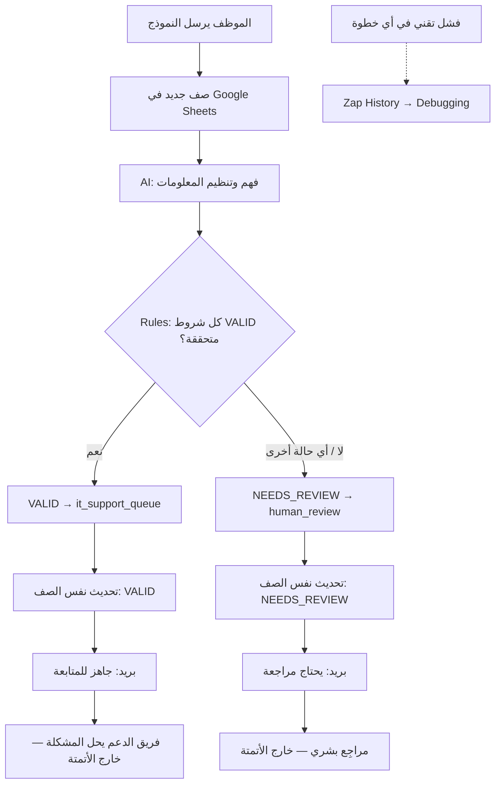

# 02 — Workflow Decomposition

## IT Support Requests

> يقسّم هذا الملف العمل الموصوف في `01-business-analysis.md` إلى عملية، وسير عمل، ومهام، ومهام فرعية، مع ترتيبها واعتماد بعضها على بعض.
> أسماء الحقول المذكورة هنا مبدئية، والتعريف النهائي لكل حقل (نوعه، وقيمه المسموحة، والتحقق منه) موجود في `03-data-design.md`.

---

## 1. Process — العملية

**IT Support Request Intake & Routing Process**

هي عملية استقبال طلب الدعم الفني من الموظف، وفهمه، وتنظيم معلوماته، والتحقق من كفايتها، ثم تحديد المسار المناسب له وتسجيل النتيجة وإبلاغ الجهة المعنية.

### حدود العملية

| | |
|---|---|
| **تبدأ عند** | إرسال الموظف لنموذج `IT-Support-Requests` |
| **تنتهي عند** | تسجيل نتيجة المعالجة في الشيت **و**إرسال الإشعار المناسب |
| **لا تشمل** | تشخيص المشكلة أو حلها أو إغلاق الطلب |

> **مهم:** انتهاء الـWorkflow **لا يعني أن المشكلة حُلّت**.
> القيمة `VALID` تعني أن الطلب **جاهز ليبدأ فريق الدعم العمل عليه**، وليس أنه أُنجز.
> حل المشكلة عمل بشري يحدث **بعد** هذه العملية وخارج نطاق الأتمتة.

---

## 2. Workflow — سير العمل

1. **Receive Request** — استقبال الطلب
2. **Understand Request** — فهم الطلب
3. **Structure Information** — تنظيم المعلومات
4. **Validate Information** — التحقق من المعلومات
5. **Route Request** — توجيه الطلب
6. **Record Results** — تسجيل النتائج
7. **Notify Relevant Person** — إبلاغ الشخص المعني

بعد انتهاء الـWorkflow (خارج الأتمتة):

8. **Human Handling** — يتعامل الإنسان مع الطلب: فريق الدعم يبدأ الحل، أو المراجِع يستكمل المعلومات.

---

## 3. Tasks — المهام

| # | Task | الوصف | من ينفذ؟ |
|---|---|---|---|
| T1 | Receive Request | استقبال بيانات الطلب من النموذج وحفظها كصف في الشيت | Google Forms + Google Sheets + Zapier Trigger |
| T2 | Understand Request | قراءة وصف المشكلة المكتوب بلغة حرة وفهمه | **AI** |
| T3 | Structure Information | تحويل الوصف إلى حقول منظمة بقيم محددة | **AI** |
| T4 | Validate Information | التحقق من وجود المعلومات المطلوبة ووضوحها | **Rules** (شروط ثابتة في Zapier) |
| T5 | Route Request | تحديد المسار: `it_support_queue` أو `human_review` | **Rules** |
| T6 | Record Results | كتابة نتائج المعالجة في **نفس صف الطلب** | Google Sheets (عبر Zapier) |
| T7 | Notify Relevant Person | إرسال بريد يناسب المسار | Gmail (عبر Zapier) |
| T8 | Human Handling | حل المشكلة أو مراجعة الطلب | **Human** (خارج الأتمتة) |

---

## 4. Subtasks — المهام الفرعية

### T1: Receive Request
- يملأ الموظف النموذج: `Requester Name`، `Requester Email`، `Department` (اختياري)، `Issue Description`.
- يرفض Google Forms الإرسال إذا كان حقل مطلوب فارغًا.
- يضيف Google Forms الرد كصف جديد في ورقة `ردود النموذج 1` مع طابع زمني.
- يلتقط Zapier الصف الجديد ويحتفظ **برقم الصف (Row ID)** لتحديثه لاحقًا.

### T2: Understand Request
- تمرير `Issue Description` فقط إلى AI. لا حاجة لإرسال الاسم أو الإيميل إلى AI.
- يقرأ AI النص سواء كان بالعربية أو الإنجليزية.

### T3: Structure Information
يستخرج AI الحقول التالية **مما هو مذكور صراحة فقط**:
- `issue_category`: نوع المشكلة من قائمة ثابتة.
- `affected_item`: الجهاز أو النظام المتأثر، أو `Not provided`.
- `issue_summary`: ملخص قصير لما ذكره الموظف.
- `security_concern`: هل يذكر النص مؤشرًا أمنيًا؟
- `missing_information`: المعلومات المطلوبة الناقصة أو الغامضة، أو `NONE`.

### T4: Validate Information
- التحقق من أن الاسم والإيميل موجودان.
- التحقق من أن `issue_category` ليس `unknown`.
- التحقق من أن `affected_item` ليس `Not provided`.
- التحقق من أن `missing_information` = `NONE`.
- التحقق من أن `security_concern` = `false`.
- التحقق من أن مخرجات AI ضمن القيم المسموحة. أي قيمة غير متوقعة تُعامل كعدم تحقق.

### T5: Route Request
- إذا تحققت **كل** الشروط في T4، يذهب الطلب إلى `it_support_queue`.
- في أي حالة أخرى يذهب إلى `human_review`.
- يذهب كل طلب إلى مسار **واحد فقط**.

### T6: Record Results
- تحديث نفس صف الطلب بالحقول المستخرجة.
- تسجيل `request_status` و`requires_human` و`routing` و`processed_at`.
- عدم إنشاء صف جديد للطلب نفسه.

### T7: Notify Relevant Person
- مسار `it_support_queue`: بريد يفيد بوجود طلب جاهز للمتابعة مع المعلومات المنظمة.
- مسار `human_review`: بريد يفيد بأن الطلب يحتاج مراجعة، مع ذكر المعلومات الناقصة أو وجود شبهة أمنية.

### T8: Human Handling (خارج الأتمتة)
- **فريق الدعم:** يبدأ بتشخيص المشكلة وحلها.
- **المراجِع:** يتواصل مع الموظف لاستكمال المعلومات، أو يتعامل مع الشبهة الأمنية حسب ما تقتضيه الحالة.
- `UNKNOWN — requires confirmation`: إجراءات الحل والتصعيد الأمني الفعلية غير معرّفة في هذا المشروع.

---

## 5. Sequence — الترتيب

```text
Receive Request
→ Understand Request
→ Structure Information
→ Validate Information
→ Route Request
→ Record Results
→ Notify Relevant Person
→ (Human Handling — خارج الأتمتة)
```

**لماذا هذا الترتيب؟**
- لا يمكن فهم الطلب قبل استقباله.
- لا يمكن التحقق من معلومات لم تُستخرج بعد.
- لا يمكن التوجيه قبل التحقق.
- نسجل النتيجة قبل الإشعار حتى يكون السجل موجودًا عندما يفتح المستلم البريد.

---

## 6. Dependencies — الاعتماديات

| Task | Depends On | ماذا تحتاج منها؟ |
|---|---|---|
| T2 Understand Request | T1 | `Issue Description` |
| T3 Structure Information | T2 | فهم AI للنص |
| T4 Validate Information | T1 + T3 | الاسم والإيميل من T1، والحقول المستخرجة من T3 |
| T5 Route Request | T4 | نتيجة التحقق |
| T6 Record Results | T1 + T3 + T5 | Row ID من T1، والحقول من T3، والمسار من T5 |
| T7 Notify Relevant Person | T5 + T6 | المسار ومحتوى الإشعار |
| T8 Human Handling | T7 | وصول الإشعار |

---

## 7. Happy Path — المسار الطبيعي

**مثال (بيانات وهمية):** طلب مكتمل وواضح، بدون شبهة أمنية.

> *"The printer on the 2nd floor (HP LaserJet) shows a paper jam error and won't print anything since this morning."*

```text
1. الموظف يرسل النموذج
2. يُضاف صف جديد في الشيت → Zapier يلتقطه
3. AI يستخرج:
     issue_category      = printer
     affected_item       = HP LaserJet printer, 2nd floor
     security_concern    = false
     missing_information = NONE
4. AI يطبق القواعد المكتوبة في الـPrompt: كل الشروط متحققة → request_status = VALID
5. المسار: it_support_queue
6. تحديث نفس الصف: VALID / requires_human = false / it_support_queue
7. بريد: "New IT Support Request — Ready for Follow-up"
8. (خارج الأتمتة) فريق الدعم يبدأ العمل على الطابعة
```

القيم أعلاه **متوقعة** حسب التصميم، وليست نتائج تشغيل فعلي. النتائج الفعلية تُسجَّل في [README](../README.md).

---

## 8. Exception Paths — مسارات الاستثناء

### 8.1 Business Exceptions — الطلب نفسه يحتاج معالجة مختلفة

النظام **عمل بشكل صحيح**، لكن الطلب لا يمكن تمريره بأمان إلى فريق الدعم.
كل هذه الحالات تنتهي بـ: `request_status = NEEDS_REVIEW` و `routing = human_review`.

| # | الحالة | مثال (وهمي) | سبب الإحالة |
|---|---|---|---|
| E1 | نوع المشكلة غير مفهوم | *"Nothing is working, please help."* | `issue_category = unknown` |
| E2 | الجهاز أو النظام غير مذكور | *"I can't open the program I need for my work."* | `affected_item = Not provided` |
| E3 | معلومات ناقصة أو غامضة أو متناقضة | *"My laptop... actually it's the desktop, or maybe both."* | `missing_information ≠ NONE` |
| E4 | شبهة أمنية | *"I clicked a link in a suspicious email and entered my password."* | `security_concern = true`، **ويُحال دائمًا لإنسان حتى لو كانت المعلومات كاملة** |
| E5 | مخرجات AI غير صالحة | قيمة خارج القائمة المسموحة، أو حقل فارغ | لا يتحقق شرط `VALID`، فيذهب الطلب تلقائيًا إلى المسار البديل |

```text
1–3. نفس خطوات المسار الطبيعي
4. AI يطبق القواعد المكتوبة في الـPrompt: شرط واحد أو أكثر غير متحقق → request_status = NEEDS_REVIEW (وأي قيمة غير VALID تذهب أيضًا إلى هذا المسار)
5. المسار: human_review
6. تحديث نفس الصف: NEEDS_REVIEW / requires_human = true / human_review
7. بريد: "IT Support Request Requires Human Review" + المعلومات الناقصة أو سبب المراجعة
8. (خارج الأتمتة) المراجِع يستكمل المعلومات أو يتعامل مع الحالة الأمنية
```

### 8.2 Technical Failures — النظام نفسه لم يعمل

هذا **ليس** استثناء أعمال، و**لا يُسجَّل** كـ`NEEDS_REVIEW`.

| # | الفشل | ماذا يحدث؟ |
|---|---|---|
| F1 | الـTrigger لم يلتقط الصف الجديد | لا يظهر Run في Zap History |
| F2 | فشل خطوة AI by Zapier | يتوقف الـRun عند خطوة AI ويظهر خطأ في Zap History |
| F3 | فشل تحديث Google Sheets | الصف يبقى بدون نتائج معالجة |
| F4 | فشل إرسال Gmail | السجل محدَّث، لكن الإشعار لم يصل |

العلاج: مراجعة **Zap History** لتحديد **أول خطوة فشلت** (Debugging by Layer)، ثم إصلاحها وإعادة التشغيل.
التفاصيل في `04-decision-and-exception-design.md`.

---

## 9. ملخص بصري



> كل طلب يمر في مسار واحد فقط، فيُحدَّث صفه مرة واحدة ويُرسل له بريد واحد. التفاصيل التقنية في `05-automation-design.md`.
