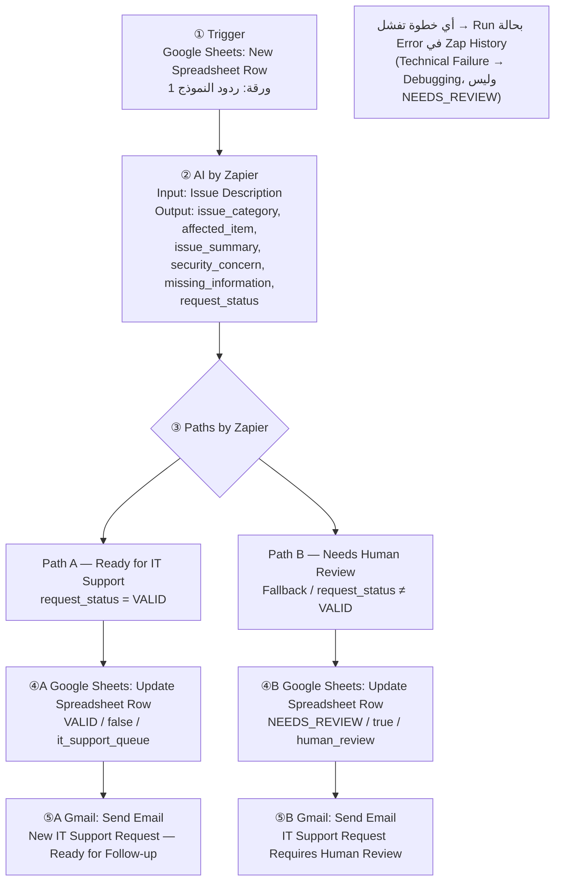

# 05 — Automation Design

## IT Support Requests

> يصمم هذا الملف الـZap كاملًا **قبل** بنائه. كل خطوة مبنية على قرار سابق في الملفات 01–04.
> *Do not start with the tool. Start with the design.*

---

## 1. Automation Goal

لكل طلب دعم فني جديد، يقوم الـZap بما يلي:

1. يستخرج المعلومات من وصف المشكلة.
2. يقرر بقواعد ثابتة هل الطلب جاهز لفريق الدعم أم يحتاج مراجعة بشرية.
3. يسجل النتيجة في **نفس صف الطلب**.
4. يرسل البريد المناسب.

---

## 2. لماذا هذه الأدوات؟ (التصميم يحدد الأداة)

| الحاجة (من التصميم) | الأداة | لماذا هي وليس غيرها؟ |
|---|---|---|
| نقطة دخول للموظف بحقول مطلوبة | **Google Forms** | يمنع الإرسال بحقول فارغة، ومجاني، ويرتبط تلقائيًا بالشيت |
| سجل واحد لكل طلب يمكن تحديثه | **Google Sheets** | يوفر Row ID لتحديث نفس الصف، ويمكن قراءته بسهولة للمراجعة والاختبار |
| محرك الأتمتة | **Zapier** | متطلب المشروع |
| فهم نص حر بالعربية والإنجليزية | **AI by Zapier** | مدمج في Zapier، ولا يحتاج حسابًا خارجيًا أو مفتاح API |
| قرار بقواعد صريحة ومسارين | **Paths by Zapier** | يوجّه ولا يوقف. أما Filter فيوقف الطلب، ونحن نريد **توجيه** الاستثناء |
| إشعار بالبريد | **Gmail** | من الأدوات المقترحة في المشروع، ويرسل من حساب Google نفسه |

**أدوات لم أستخدمها ولماذا:**
- **Filter by Zapier:** يوقف الطلبات غير المطابقة، بينما الهدف هو *Route the exception*.
- **Formatter by Zapier / Code:** لا حاجة لها، فالثوابت تُكتب مباشرة في خطوات المسارات.
- **Email by Zapier:** Gmail كافٍ، ويجعل المرسِل حسابًا معروفًا.

---

## 3. End-to-End Flow



**الشكل المختصر:**

```text
Google Form ─► Google Sheets (صف جديد)
                    │
            ① Trigger: New Spreadsheet Row
                    │
            ② AI by Zapier (استخراج + request_status)
                    │
            ③ Paths by Zapier (توجيه حسب request_status)
             ┌──────┴───────┐
        Path A           Path B (Fallback)
        VALID            NEEDS_REVIEW
             │                │
   ④A Update Row       ④B Update Row
             │                │
   ⑤A Gmail             ⑤B Gmail
```

---

## 4. الخطوات بالتفصيل

### ① Trigger — Google Sheets: New Spreadsheet Row

| | |
|---|---|
| **لماذا موجودة؟** | تبدأ الأتمتة عند وصول طلب جديد، وتوفر Row ID لتحديث نفس الصف |
| **الإعداد** | Spreadsheet: `IT-Support-Requests (الردود)` — Worksheet: `ردود النموذج 1` |
| **Data Out** | `طابع زمني`، `Requester Name`، `Requester Email`، `Department`، `Issue Description`، و**Row ID** |
| **تحذير** | ليس **New or Updated** Spreadsheet Row، لأن الـZap يحدّث الصف بنفسه، فسيعيد تشغيل نفسه (Loop) |

### ② AI by Zapier — استخراج المعلومات وتطبيق القواعد

| | |
|---|---|
| **لماذا موجودة؟** | تحويل الوصف الحر إلى حقول منظمة (Unstructured → Structured)، ثم تطبيق القواعد V3–V6 المكتوبة في الـPrompt |
| **Data In** | `issue_description` ← `Issue Description` من الخطوة ① **فقط** |
| **Data Out** | `issue_category`، `affected_item`، `issue_summary`، `security_concern`، `missing_information`، `request_status` (كلها Text) |
| **لا يُخرج** | `routing` ولا `requires_human`، فهي قيم ثابتة في كل مسار |
| **طريقة المحاضرة** | AI يرجع `request_status` بنفسه، وفق قواعد مكتوبة صراحة في الـPrompt (تغيير بتاريخ 2026-10-15، انظر `04` القسم 2) |
| **التعليمات (Prompt)** | النص الكامل في [README](../README.md) |

**قاعدة البناء:** لا تُبنى المسارات قبل التأكد من أن مخرجات AI صحيحة لحالة اختبار واحدة على الأقل (*AI PASS ✅*).
السبب: *Garbage In → Garbage Out*.

### ③ Paths by Zapier — التوجيه

| | |
|---|---|
| **لماذا موجودة؟** | إرسال كل طلب إلى مسار واحد حسب `request_status` |
| **Data In** | `request_status` من ② |

#### Path A — `Ready for IT Support`

قاعدة واحدة:

| الحقل | الشرط | القيمة |
|---|---|---|
| `request_status` (②) | (Text) Exactly matches | `VALID` |

#### Path B — `Needs Human Review`

- **الخيار المفضل:** إعداده كـ**Fallback Path**، أي يعمل فقط إذا لم يتحقق أي مسار آخر.
- **البديل** إن لم يتوفر خيار Fallback في الواجهة: `request_status` (Text) **Does not exactly match** `VALID` (القسم 5).

### ④A / ④B — Google Sheets: Update Spreadsheet Row

| | |
|---|---|
| **لماذا موجودة؟** | حفظ نتيجة المعالجة في نفس سجل الطلب (Tracking، Review، Testing، Debugging) |
| **Row** | Row ID من الخطوة ① |
| **لماذا داخل كل مسار وليس بعدهما؟** | لأن القيم الثلاث `request_status` و`requires_human` و`routing` **ثابتة ومختلفة** في كل مسار |

| العمود | ④A (Path A) | ④B (Path B) |
|---|---|---|
| `issue_category` | من ② | من ② |
| `affected_item` | من ② | من ② |
| `issue_summary` | من ② | من ② |
| `security_concern` | من ② | من ② |
| `missing_information` | من ② | من ② |
| `request_status` | `VALID` (ثابت) | `NEEDS_REVIEW` (ثابت)* |
| `requires_human` | `false` (ثابت) | `true` (ثابت) |
| `routing` | `it_support_queue` (ثابت) | `human_review` (ثابت) |
| `processed_at` | وقت التشغيل من Zapier | وقت التشغيل من Zapier |
| الأعمدة A–E | **لا تُلمس** | **لا تُلمس** |

\* تُكتب كقيمة ثابتة وليس من ②. إذا أرجع AI قيمة غير متوقعة (فارغة أو خطأ إملائي) ودخل الطلب Path B، يبقى الشيت متسقًا: `NEEDS_REVIEW` / `true` / `human_review`.

### ⑤A / ⑤B — Gmail: Send Email

| | |
|---|---|
| **لماذا موجودة؟** | إبلاغ الجهة المسؤولة. التسجيل وحده لا يكفي، فالاستثناء يجب ألا يختفي في الشيت |
| **لماذا بعد التحديث؟** | حتى يكون السجل موجودًا عندما يفتح المستلم البريد |
| **To** | بريد تجريبي يمثل فريق الدعم والمراجِع (`ASSUMPTION — not confirmed by the assignment`: في جهة حقيقية سيكونان عنوانين مختلفين) |

**⑤A — Subject:** `New IT Support Request — Ready for Follow-up`

> صيغة البريد على نمط مثال المحاضرة (2026-10-16): سطر افتتاحي، ثم الحقول المهمة، ثم الطلب الأصلي، ثم الإجراء المطلوب.

```text
A new IT support request is ready for follow-up.

Requester: {{Requester Name}}
Email: {{Requester Email}}
Department: {{Department}}

Category:
{{issue_category}}

Affected Item:
{{affected_item}}

Summary:
{{issue_summary}}

Original Request:
{{Issue Description}}

Please start working on this request. It has not been resolved yet.
```

**⑤B — Subject:** `IT Support Request Requires Human Review`

```text
A new IT support request requires human review.

Requester: {{Requester Name}}
Email: {{Requester Email}}
Department: {{Department}}

Missing Information:
{{missing_information}}

Security Concern:
{{security_concern}}

Original Request:
{{Issue Description}}

Please review the request before proceeding. If Security Concern is true, handle it as a possible security incident.
```

**لماذا أُضيف `Security Concern` إلى ⑤B مع أنه ليس في مثال المحاضرة؟** لأن E4 (الشبهة الأمنية) يجب أن يذكرها البريد صراحة (`04`، القسم 5)، حتى لا يتعامل المراجِع معها كطلب ناقص عادي.

---

## 5. ضمان عدم التداخل بين المسارين

| الطريقة | الإعداد | التقييم |
|---|---|---|
| **1 (مفضلة)** | Path B = **Fallback** | مضمونة: B يعمل فقط عندما لا يعمل A |
| **2 (بديل)** | Path B: `request_status` (Text) **Does not exactly match** `VALID` | عكس A تمامًا |

> **لماذا ليس `Exactly matches NEEDS_REVIEW`؟** لأن AI قد يرجع قيمة فارغة أو غير متوقعة، فلا تطابق A ولا B ويضيع الطلب. شرط "ليس `VALID`" يلتقط كل ما عدا `VALID`.

---

## 6. Data Passed Between Steps — ملخص تدفق البيانات

| من | إلى | البيانات |
|---|---|---|
| ① Trigger | ② AI | `Issue Description` |
| ② AI | ③ Paths | `request_status` |
| ① Trigger | ④A/④B | Row ID |
| ② AI | ④A/④B | الحقول الخمسة |
| ① + ② | ⑤A/⑤B | الاسم، والبريد، والقسم، والوصف، والحقول المستخرجة |

---

## 7. Exception & Failure Handling في التصميم

| النوع | أين يُعالج في الـZap؟ |
|---|---|
| Business Exceptions (E1–E5) | **Path B** يوجّهها إلى `human_review` ويرسل بريد ⑤B |
| Technical Failures (F1–F6) | **لا يعالجها الـZap تلقائيًا**. تظهر كـRun بحالة Error في Zap History، وتُصحح يدويًا (انظر `04`، الأقسام 6–8) |

> لم أضف خطوات Error Handling تلقائية (مثل بريد عند فشل خطوة)، لإبقاء النسخة صغيرة وواضحة.
> مراقبة Zap History هي آلية اكتشاف الأعطال في هذه النسخة.

---

## 8. Testing Requirements — متطلبات الاختبار

### ترتيب البناء والاختبار

1. **Trigger:** Test Trigger يجب أن يجلب صفًا تجريبيًا.
2. **AI:** اختبار على حالة TC01 → *AI PASS* قبل بناء المسارات.
3. **Paths:** التأكد من أن TC01 تدخل Path A.
4. **Update Row:** التأكد من تحديث **نفس الصف** وعدم إنشاء صف جديد.
5. **Gmail:** التأكد من وصول البريد.
6. **تشغيل الـZap (Publish / On)** ثم إرسال كل حالات الاختبار **من النموذج**.

### حالات الاختبار المطلوبة

| # | السيناريو | يغطي | المسار المتوقع |
|---|---|---|---|
| TC01 | طلب مكتمل (طابعة) | Happy Path | A |
| TC02 | وصف غامض جدًا | E1 | B |
| TC03 | الجهاز أو النظام غير مذكور | E2 | B |
| TC04 | شبهة أمنية مع معلومات كاملة | E4 | B |
| TC05 | طلب بالعربية (تسجيل دخول) | اللغة العربية + `account_access` | A |
| TC06 | فئة `other` مع معلومات كاملة | `other` لا تعني نقصًا | A |
| TC07 | وصف متناقض | E3 | B |
| TC08 | نسيان كلمة المرور فقط | `security_concern = false` | A |

نص كل حالة، والنتائج المتوقعة والفعلية، موجودة في [README](../README.md).

### ما يُفحص في كل حالة

مخرجات AI ← المسار ← الشيت (نفس الصف، والقيم الثلاث متسقة) ← البريد ← **Expected vs Actual** ← PASS / FAIL.
