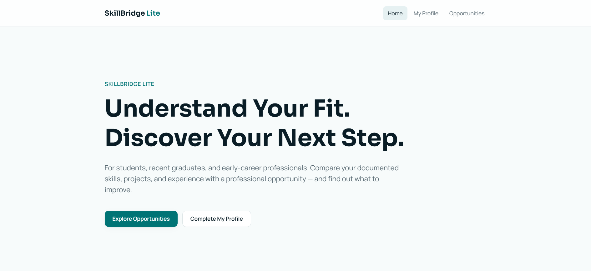
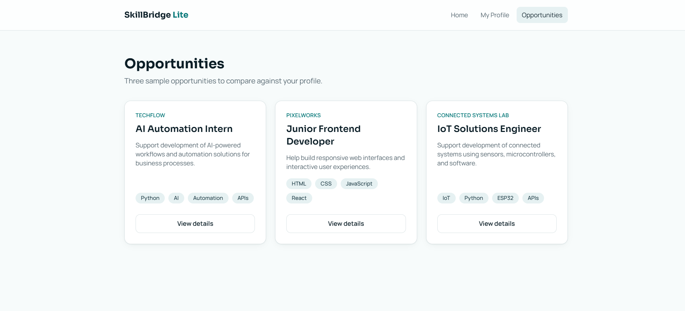

# SkillBridge Lite — AI-Powered Career Fit Assistant

> A web app that compares a professional profile with a selected opportunity and returns evidence-based AI feedback: relevant skills, potential gaps, and recommended next steps — without inventing anything about the user.

**🌐 English** · [العربية](#-النسخة-العربية)



---

## 🎯 Problem

### The Context

Students, recent graduates, and early-career professionals have skills, projects, and some experience, and they apply to internships and junior roles that each list their own requirements.

### The Problem

It is hard to turn scattered professional information into a clear picture of how it relates to one specific opportunity:

- Which of my skills relate to this opportunity?
- What evidence in my projects and experience supports my fit?
- Which requirements have I not shown enough information about?
- What can I do next to be better prepared?

### Why It Matters

A clear, honest comparison helps the user prepare for the right opportunity and improve their profile. Generic AI tools often flatter or invent skills, so their advice cannot be trusted.

---

## 💡 Solution

A small web app built with **Lovable**, with one focused AI function.

What does the system do?

1. Lets the user review and edit their professional profile.
2. Shows three built-in sample opportunities, each with details.
3. Compares the profile with the selected opportunity using AI.
4. Shows the result in three sections: **Relevant Skills**, **Potential Gaps**, **Recommended Next Steps**.

| My profile | Opportunities |
|---|---|
|  |  |

---

## 👤 Users

**Primary Users:**  
One user: a student, recent graduate, or early-career professional.

**User Need:**  
Understand how their profile relates to a specific opportunity, and what to do next to improve their readiness.

---

## 🧠 How I Designed the Solution

The project followed the five U2 layers before and during the build:

| Layer | Output |
|---|---|
| 01 — Understand the User | User definition: who, goal, need, context |
| 02 — Define the Solution | Problem statement, solution, MVP scope |
| 03 — Design the Experience | Screens, navigation, and interactions |
| 04 — Design the System | Data, inputs, outputs, and system logic |
| 05 — Specify & Build with AI | Clear specifications that guided Lovable → working prototype |

**MVP first:** five features only. Deliberately **out of scope**: login, database, admin dashboard, multiple roles, saved opportunities, resume generation, automatic applications, hiring-probability predictions, and AI agents.

> *Build the smallest useful solution that solves the right problem.*

---

## ⚙️ How It Works

```text
HOME
  ↓
MY PROFILE  (view and edit)
  ↓
EXPLORE OPPORTUNITIES  (three sample opportunities)
  ↓
OPPORTUNITY DETAILS
  ↓
ANALYZE MY FIT  (profile + opportunity → AI)
  ↓
AI FIT ANALYSIS  (relevant skills · potential gaps · next steps)
```


---

## 🤖 Role of AI

What does AI do in this solution?

- Compares the profile with the opportunity's required skills and responsibilities.
- Lists **relevant skills**, each with an **exact quote from the profile** as evidence and why it matters for the role.
- Lists **potential gaps**: requirements the profile does not provide enough evidence for.
- Suggests **recommended next steps**, each with a reason.

### What AI Should NOT Do

- Invent skills, projects, qualifications, or experience that are not in the profile.
- Treat missing information as proof that a skill is missing — it says *"not documented"* instead.
- Guarantee hiring or predict a hiring outcome.
- Present a sample result as if it were a real AI analysis.

Every result ends with a clear note that the analysis is an estimate, not a final judgment:


---

## 🔄 Automation

What parts of the process are automated?

- Checking that the profile has enough data before running the analysis.
- Sending the profile and the opportunity to the AI and receiving a structured result.
- Validating the result: exactly three sections, no empty details, and every evidence quote must exist in the profile — otherwise the result is rejected.
- Showing a clear state for each case: success, incomplete profile, AI unavailable, or invalid answer.

---

## 🗂️ Data

### Input

- **Profile:** name, headline, about, skills, projects, experience.
- **Opportunity:** title, company, description, required skills, responsibilities.

There is no database: the profile is kept in the app state for the current session, and the three opportunities are built into the app.

### Output

| Section | Each entry contains |
|---|---|
| Relevant Skills | skill · evidence quoted from the profile · relevance |
| Potential Gaps | requirement · reason |
| Recommended Next Steps | action · reason |

---

## 🛠️ Tools & Technologies

| Tool | Purpose |
|---|---|
| Lovable | AI app builder used to build and refine the app step by step |
| React, TanStack Start, Tailwind CSS | Generated frontend and server function |
| AI (structured output) | Fit analysis returning the three required sections |
| Zod, Vitest | Output validation and unit tests |
| GitHub | Code repository synced with Lovable |

---

## 🔑 Key Design Decisions

### Decision 1

**Decision:**  
Every relevant skill must include an exact quote from the profile, and the app checks that the quote really exists.

**Why:**  
This makes the analysis verifiable. If the AI quotes something the user never wrote, the result is rejected instead of shown.

### Decision 2

**Decision:**  
No database, no login — the profile lives in the session.

**Why:**  
The goal of U2 is a working MVP around one user flow. Authentication and a database would add complexity and credits without serving the core flow.

### Decision 3

**Decision:**  
Build incrementally in Lovable: foundation → core experience → opportunity flow → AI analysis → review and refine.

**Why:**  
One huge prompt is hard to control and expensive. Small, clear steps keep what was already built and reduce credit use.

---

## 🧪 Testing

### Test 1 — Real profile vs AI Automation Intern

**Input:**  
My real profile (skills, five projects, course experience) against the **AI Automation Intern** opportunity.

**Expected Result:**  
Relevant skills with quotes from the profile; gaps only where evidence is missing; next steps with reasons; the disclaimer under the result.

**Actual Result:**  
Relevant skills such as *Workflow automation* and *AI service integration*, each quoting a project from the profile. **Python** appeared as a gap: *"Python is listed, but a project demonstrating Python automation code is not documented"* — correct, because Python was listed as a skill without a project to support it. The disclaimer appeared under the result.

**Status:** ✅

---

### Test 2 — Output validation (unit tests)

**Input:**  
Valid and invalid AI outputs: extra fields (for example `hiringGuarantee`), a skill without evidence, a gap or step without a reason, blank evidence, and plain string lists.

**Expected Result:**  
Only the three required sections with complete details are accepted; everything else is rejected.

**Actual Result:**  
3 test files, **12 / 12 tests passed**.

**Status:** ✅

---

## 📸 Evidence

### Final Result


### Workflow

```text
Home → My Profile → Opportunities → Opportunity Details → Analyze My Fit → AI Fit Analysis
```

---

## ⚠️ Challenges & Failures

What didn't work as expected?

- The project was created as a **remix**, so the repository kept the README of the original project (wrong name and wrong live link).
- Renaming the repository directly on GitHub broke the connection with Lovable.
- The specification requires saying that the result is an estimate, not a final judgment, and the first version did not show this.

How did I solve it?

- Wrote a new README for the project instead of the copied one.
- Reconnected the project to a new repository from Lovable, and now make repository changes from Lovable only.
- Added a disclaimer under every AI result with one focused prompt, without changing anything else.

---

## 📚 What I Learned

### Technical Lesson

How a Lovable project connects to GitHub, what a remix does and does not copy, and how structured AI output can be validated in code before it reaches the user.

### Problem-Solving Lesson

Defining the MVP and what *not* to build first made the build faster and kept the app focused on one clear user flow.

### AI Lesson

A trustworthy AI feature needs two layers: clear rules in the prompt, and checks in the code. The Python gap showed the app working as designed: it separates a skill that is *listed* from a skill that is *proven*.

---

## 🔮 Future Improvements

If I continued developing this project, I would:

- Keep profile edits after a page refresh (browser storage).
- Let users paste their own opportunity text, not only the built-in ones.
- Save analyses so progress can be compared over time.
- Add an Arabic interface and analysis.

---

## 🔗 Project Links

**Live Demo:** [skillbridge-lite.lovable.app](https://skillbridge-lite.lovable.app)

**Workflow:** N/A (web app — the user flow is shown above)

**Repository:** [skillbridge-lite](https://github.com/Dina-Albaghdadi/skillbridge-lite)

---

## 👩‍💻 Author

**Dina Albaghdadi**

[LinkedIn](https://www.linkedin.com/in/dina-albaghdadi-79bb9a25a/) · [GitHub](https://github.com/Dina-Albaghdadi)

---
---

<div dir="rtl">

## 🌍 النسخة العربية

> تطبيق ويب يقارن الملف المهني بفرصة مختارة، ويعطي ملاحظات مدعومة بالذكاء الاصطناعي ومبنية على أدلة: المهارات المناسبة، والفجوات المحتملة، والخطوات المقترحة، بدون اختراع أي معلومة عن المستخدم.

> الصور موجودة في النسخة الإنجليزية أعلاه.

### 🎯 المشكلة

الطلاب والخريجون الجدد والمهنيون في بداية مسيرتهم يملكون مهارات ومشاريع وخبرات، لكنهم يجدون صعوبة في فهم علاقة ملفهم بفرصة محددة: ما المهارات المرتبطة؟ وما الأدلة؟ وما المتطلبات التي لم يقدموا عنها معلومات كافية؟ وما الخطوة التالية؟

### 💡 الحل

تطبيق صغير مبني بـ**Lovable** بوظيفة AI واحدة واضحة: عرض الملف وتعديله، واستعراض ثلاث فرص تجريبية وتفاصيلها، ثم تحليل التوافق وعرض النتيجة في ثلاثة أقسام.

### 👤 المستخدمون

مستخدم واحد: طالب أو خريج جديد أو مهني في بداية مسيرته، يريد فهم علاقة ملفه بفرصة محددة وما يمكنه فعله للتحسن.

### 🧠 كيف صممت الحل

مررت بطبقات U2 الخمس: فهم المستخدم، ثم تعريف الحل والـMVP، ثم تصميم التجربة، ثم تصميم النظام والبيانات، ثم كتابة المواصفات والبناء بـLovable. وحددت ما **لن** أبنيه: تسجيل الدخول، وقاعدة البيانات، ولوحة الإدارة، والأدوار المتعددة، وتوقع فرص القبول.

### 🤖 دور الذكاء الاصطناعي

**ماذا يفعل:** يقارن الملف بمتطلبات الفرصة، ويذكر المهارات المناسبة مع **اقتباس حرفي من الملف** كدليل، والفجوات، والخطوات المقترحة مع أسبابها.

**ما لا يفعله:** لا يخترع مهارات أو خبرات، ولا يعتبر غياب المعلومة دليلًا على غياب المهارة (يقول "غير موثّق")، ولا يضمن التوظيف، ولا يعرض نتيجة تجريبية على أنها حقيقية. وتنتهي كل نتيجة بملاحظة أنها تقدير مساعد وليست حكمًا نهائيًا.

### 🔄 الأتمتة

التحقق من اكتمال الملف قبل التحليل، وإرسال الملف والفرصة للذكاء الاصطناعي، وفحص الرد (ثلاثة أقسام، بدون تفاصيل فارغة، وكل اقتباس يجب أن يكون موجودًا في الملف وإلا يُرفض الرد)، وعرض حالة واضحة لكل احتمال.

### 🔑 قرارات التصميم

1. **كل مهارة مع اقتباس من الملف** يتحقق منه التطبيق، ليصبح التحليل قابلًا للتحقق.
2. **بدون قاعدة بيانات ولا تسجيل دخول**، لأن هدف الوحدة MVP حول تدفق واحد.
3. **البناء على مراحل** بدل أمر واحد ضخم، للتحكم بالنتيجة وتقليل استهلاك الـCredits.

### 🧪 الاختبارات

- **ملفي الحقيقي مقابل فرصة AI Automation Intern:** ظهرت المهارات المناسبة مع اقتباسات من مشاريعي، وظهرت **Python** كفجوة لأنها مذكورة كمهارة بدون مشروع يثبتها، وهذا صحيح، وظهرت ملاحظة التقدير تحت النتيجة ✅
- **اختبارات الوحدة لفحص الرد:** 12 من 12 نجحت، فالرد يُقبل فقط إذا احتوى الأقسام الثلاثة بتفاصيل كاملة ✅

### ⚠️ التحديات وكيف حللتها

- المشروع أُنشئ بـRemix فاحتفظ الريبو بـREADME المشروع الأصلي، فكتبت README جديدًا.
- تغيير اسم الريبو من GitHub قطع الربط مع Lovable، فأعدت الربط بريبو جديد من Lovable وصرت أعدّل من Lovable فقط.
- المواصفات تطلب توضيح أن النتيجة تقدير وليست حكمًا نهائيًا، فأضفت ملاحظة تحت كل نتيجة بأمر واحد مركّز.

### 📚 ماذا تعلمت

- **تقنيًا:** كيف يرتبط مشروع Lovable بـGitHub، وماذا ينسخ الـRemix وماذا لا ينسخ، وكيف يُفحص رد الـAI المنظم في الكود قبل أن يراه المستخدم.
- **حل المشكلات:** تحديد الـMVP وما لن نبنيه أولًا جعل البناء أسرع وأوضح.
- **الذكاء الاصطناعي:** الميزة الموثوقة تحتاج طبقتين: قواعد واضحة في التعليمات، وفحص في الكود.

### 🔮 تحسينات مستقبلية

حفظ تعديلات الملف بعد تحديث الصفحة، وإضافة فرص يكتبها المستخدم، وحفظ التحليلات للمقارنة، وواجهة وتحليل بالعربية.

</div>
