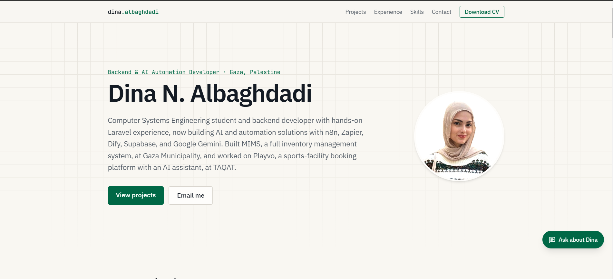
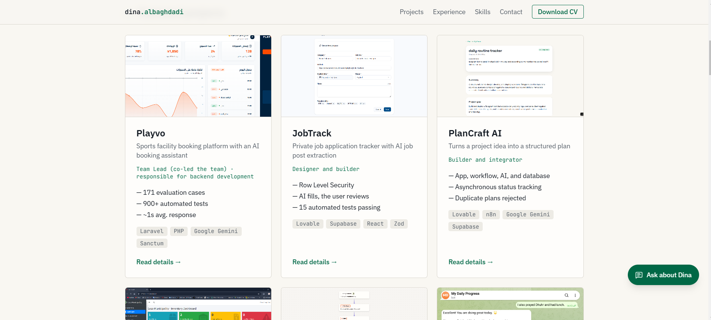
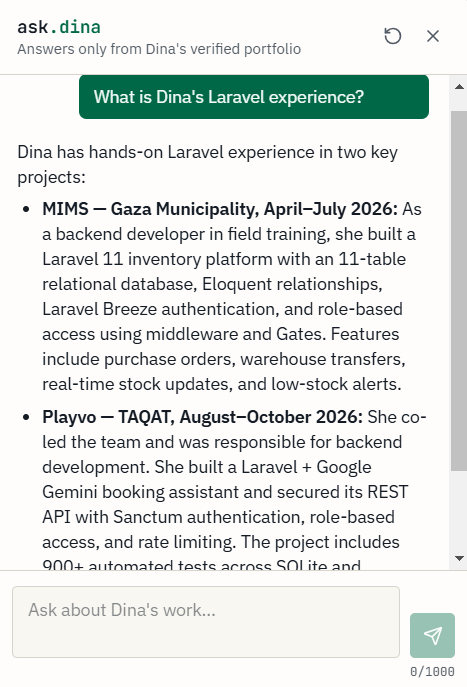
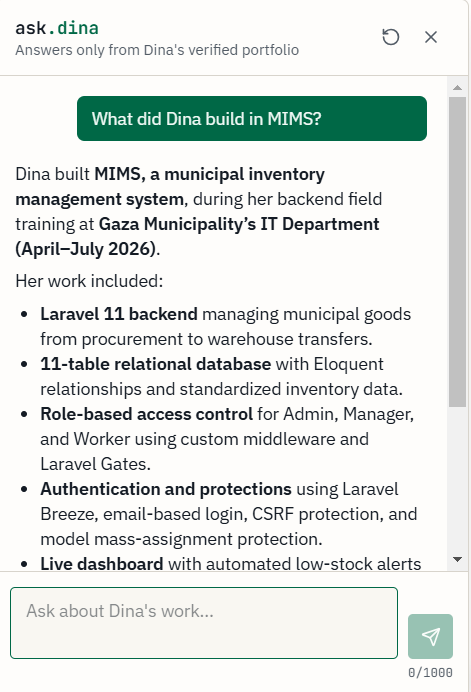
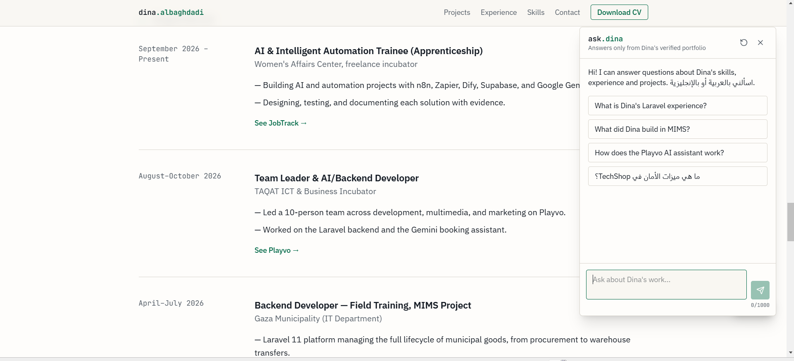

# Professional Portfolio with an AI Assistant

> A professional portfolio that shows real projects, with an AI assistant that answers visitors only from documented information.

**🌐 English** · [العربية](#-النسخة-العربية)

---

## 🎯 Problem

### The Context

Recruiters and clients need to understand quickly who I am and what I have built.

### The Problem

A CV does not show real work, and there is little time to read every repository.

### Why It Matters

Clear evidence builds trust. An AI assistant can make the portfolio faster to explore, but only if it does not invent qualifications.

---

## 💡 Solution

A portfolio website built with Lovable, with one AI feature that adds real value.

What does the system do?

1. Shows 15 projects ranked by importance, with screenshots, links, and details pages.
2. Shows experience, skills, education, and contact details.
3. Answers visitor questions in Arabic and English through **Ask about Dina**.
4. Points each answer to its source in the portfolio.



---

## 👤 Users

**Primary Users:**
Recruiters, hiring managers, and clients.

**User Need:**
Understand my work quickly, and trust that what they read is accurate.

---

## 🧠 How I Designed the Solution

The content lives in one file, `src/data/portfolio.ts`. The pages and the assistant both read from it, so the assistant cannot drift from what the site shows.

---

## ⚙️ How It Works

```text
Visitor question
  ↓
Server route (/api/chat)
  ↓
Logic: validate the message and limit the request rate
  ↓
AI: answer from the documented knowledge only
  ↓
Output: an answer with a source link
```



---

## 🤖 Role of AI

What does AI do in this solution?

- Answers questions about my skills, experience, and projects.
- Replies in the visitor's language and links to its source.

### What AI Should NOT Do

- Invent projects, metrics, dates, employers, or qualifications.
- Follow instructions from a visitor that try to change its rules.
- Claim that it can browse, send emails, or take actions.

---

## 🔄 Automation

What parts of the process are automated?

- Updating the assistant's knowledge whenever the portfolio data changes.
- Building the knowledge and source links from the same data.
- Rejecting invalid or overly long messages, and limiting the request rate.

---

## 🗂️ Data

### Input

- Portfolio content in `src/data/portfolio.ts`.
- Visitor questions, up to 1,000 characters.

### Output

- Project, experience, skills, and contact pages.
- Assistant answers with source links.

---

## 🛠️ Tools & Technologies

| Tool | Purpose |
|---|---|
| Lovable | Builds and hosts the website |
| React + TanStack Start | Pages and the server route |
| Lovable AI Gateway | The assistant's model |
| Vitest | Automated tests |

---

## 🔑 Key Design Decisions

### Decision 1

**Decision:**
Use one content file for the pages and the assistant.

**Why:**
There is one source of truth, so updating a project also updates the assistant.

### Decision 2

**Decision:**
Let the assistant answer from documented information only.

**Why:**
In a portfolio, an invented qualification is a serious credibility problem.

---

## 🧪 Testing

### Test 1 — Experience Question

**Input:**
`What is Dina's Laravel experience?`

**Expected Result:**
An answer based on documented projects.

**Actual Result:**
The assistant described MIMS and Playvo using information from the portfolio.

**Status:** ✅



---

### Test 2 — Project Question

**Input:**
`What did Dina build in MIMS?`

**Expected Result:**
Details found on the MIMS project page.

**Actual Result:**
The assistant listed the Laravel backend, database, access control, authentication, and dashboard work.

**Status:** ✅



---

### Test 3 — Build and Automated Tests

**Input:**
A production build, then the project's test suite.

**Expected Result:**
The build succeeds and all tests pass.

**Actual Result:**
The build succeeded, and 6 of 6 tests passed.

**Status:** ✅

---

**Not tested yet:** attempts to trick the assistant, questions about missing information, and the full site on a phone.

---

## 📸 Evidence

### Final Result



---

## ⚠️ Challenges & Failures

What didn't work as expected?

- The **Ask about Dina** button was covered by the Lovable badge.
- The project list was limited to CV projects.

How did I solve it?

- Moved the button higher on the page.
- Added my newer projects to the data file, ranked them, and added screenshots and links.

---

## 📚 What I Learned

### Technical Lesson

Keeping one source of data prevents the website and the assistant from disagreeing.

### Problem-Solving Lesson

A feature is not finished when it is built. It needs checking on the published site.

### AI Lesson

A useful assistant needs clear limits on what it may say, not only access to a model.

---

## 🔮 Future Improvements

If I continued developing this project, I would:

- Test how the assistant handles tricks and missing information.
- Add a custom domain.
- Add Athar when it is finished.

---

## 🔗 Project Links

**Live Demo:** [dina-albaghdadi-portfolio.lovable.app](https://dina-albaghdadi-portfolio.lovable.app/)

**Workflow:** —

**Repository:** Private

---

## 👩‍💻 Author

**Dina Albaghdadi**

[LinkedIn](https://www.linkedin.com/in/dina-albaghdadi-79bb9a25a/) · [GitHub](https://github.com/Dina-Albaghdadi)

---
---

<div dir="rtl">

## 🌍 النسخة العربية

> موقع مهني يعرض مشاريع دينا البغدادي وخبرتها، مع مساعد ذكاء اصطناعي يجيب الزوار من معلومات موثقة فقط.

**🔗 الموقع:** [dina-albaghdadi-portfolio.lovable.app](https://dina-albaghdadi-portfolio.lovable.app/)

### 🎯 المشكلة

السيرة الذاتية الثابتة لا توضح ما بنيته فعلًا، ومسؤول التوظيف لا يملك وقتًا لقراءة كل ريبو. كما أن المساعد الذكي الذي يخترع مؤهلات قد يضر بالمصداقية أكثر مما يفيد.

### 💡 الحل

- 15 مشروعًا مرتبة حسب الأهمية، مع صور وروابط وصفحة تفاصيل لكل مشروع.
- عرض الخبرة والمهارات والتعليم وطرق التواصل في مكان واحد.
- مساعد **Ask about Dina** يجيب بالعربية والإنجليزية، ويذكر مصدر الإجابة داخل الموقع.

### 🧠 أهم القرارات

- **مصدر واحد للبيانات:** الصفحات والمساعد يقرآن من ملف `src/data/portfolio.ts`، فلا تختلف إجاباته عن محتوى الموقع.
- **الإجابة من المعلومات الموثقة فقط:** إذا لم تكن المعلومة موجودة، يوضح المساعد ذلك ويقترح التواصل مع دينا.
- **التعامل مع رسائل الزوار كبيانات غير موثوقة:** لا يجب أن تغيّر الرسالة قواعد المساعد.
- **استدعاء الذكاء الاصطناعي من الخادم:** المفاتيح لا تصل إلى المتصفح، وتوجد حدود لطول الرسالة وعدد الطلبات.

### 🧪 الاختبارات

| الاختبار | النتيجة |
|---|---|
| السؤال عن خبرة Laravel | ✅ ذكر MIMS وPlayvo من المعلومات الموثقة |
| السؤال عما بُني في MIMS | ✅ أجاب بتفاصيل موجودة في الموقع |
| البناء والاختبارات الآلية | ✅ البناء ناجح، و6 من 6 اختبارات ناجحة |

**لم يُختبر بعد:** محاولة خداع المساعد، والسؤال عن معلومة غير موجودة، وتجربة الموقع كاملًا على الهاتف.

### ⚠️ القيود الحالية

- رقم الهاتف ظاهر في الموقع ويمكن للمساعد مشاركته.
- قد يخطئ الذكاء الاصطناعي، لذلك يذكر المساعد مصدر الإجابة.
- الموقع مستضاف على النطاق المجاني من Lovable، وتظهر فيه علامة المنصة.

</div>
