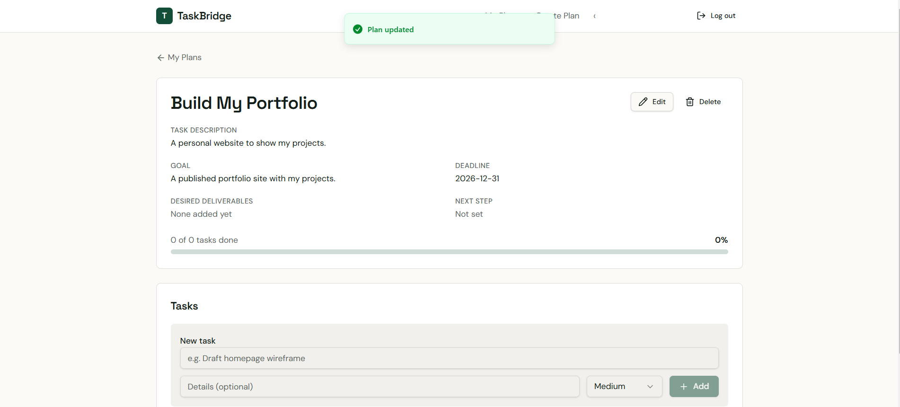
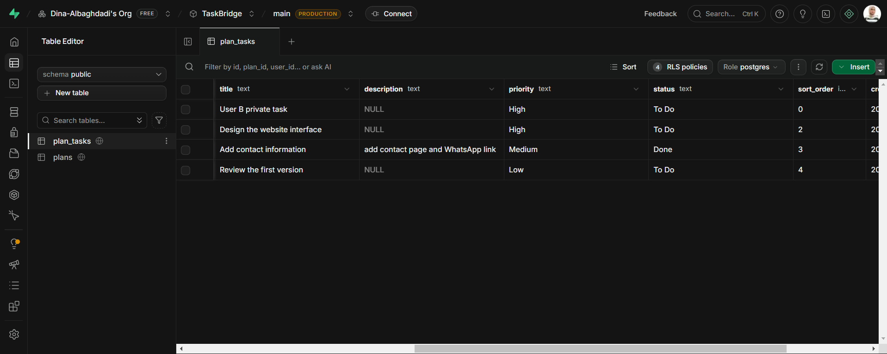
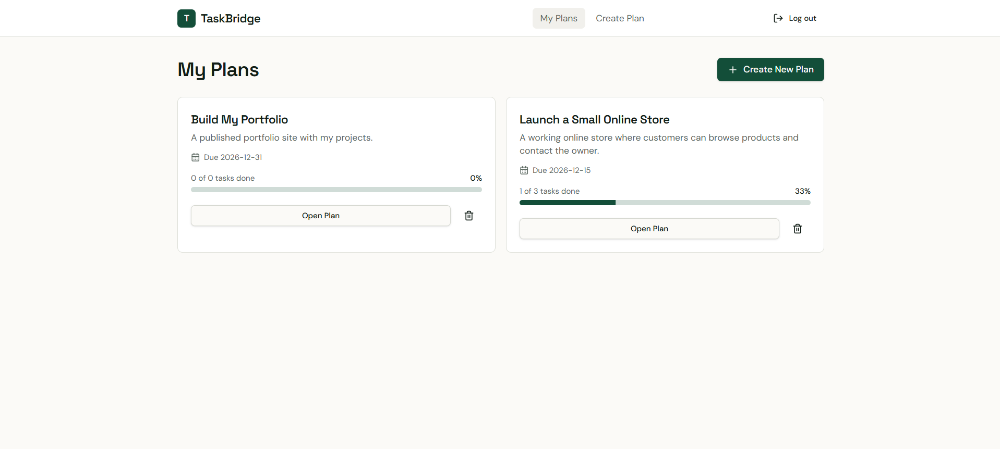

# TaskBridge — Work Planning Web Application

> A responsive web app that turns unclear work requests into clear plans with tasks, priorities, statuses, and a progress bar — with authentication, persistent storage, and database-level access control.

**🌐 English** · [العربية](#-النسخة-العربية)


---

## 🎯 Problem

### The Context

Freelancers, recent graduates, and early-career professionals often receive requests or set goals without a clear way to break them into steps.

### The Problem

A person may know what they want to achieve, but not how to turn it into actionable work: which tasks are needed, which come first, what is done, and what is next.

### Why It Matters

Without a clear plan, it is hard to organize work, set priorities, and track progress — and requests get delayed or forgotten.

---

## 💡 Solution

A web app built with **Lovable** and **Supabase** that follows one flow:

**Goal → Plan → Tasks → Priorities → Status → Progress**

What does the system do?

1. Lets each user sign up, sign in, and sign out.
2. Lets the user create, view, edit, and delete plans (title, description, goal, deadline).
3. Lets the user add, edit, and delete tasks inside a plan, with a priority and a status.
4. Calculates progress automatically: `(Done tasks ÷ Total tasks) × 100`, and `0%` when a plan has no tasks.
5. Keeps every user's data private using Row Level Security in the database.



---

## 👤 Users

**Primary Users:**  
Freelancers, recent graduates, early-career professionals, and individuals organizing their own goals (single-user use, no team collaboration in this version).

**User Need:**  
Turn a goal into clear tasks, decide what to do first, and see how much of the plan is done.

---

## 🧠 How I Designed the Solution

**Build the System, Not the Screen.** The data model and security were designed before the interface:

- **Data model:** `User → Plans → Tasks`. A user owns many plans; a plan contains many tasks; every task belongs to one plan and has the same owner as that plan.
- **Data integrity:** priority and status accept only allowed values; deleting a plan deletes its tasks (`ON DELETE CASCADE`).
- **Security:** RLS on both tables, so a user can only read or change their own records — enforced by the database, not hidden by the interface.
- **Build in stages:** Supabase setup → connect Lovable → interface → functions → testing.

---

## ⚙️ How It Works

```text
Sign up / Sign in (Supabase Auth)
  ↓
My Plans  ── shows only the signed-in user's plans (RLS)
  ↓
Create / Edit Plan  (title · description · goal · deadline)
  ↓
Plan Details
  ├─ Add / edit / delete tasks
  ├─ Priority: High · Medium · Low
  ├─ Status:   To Do · In Progress · Done
  ↓
Progress = Done ÷ Total × 100   (0% when there are no tasks)
```


---

## 🤖 Role of AI

What does AI do in this solution?

- **Lovable** (an AI app builder) generated the interface and the app logic from the written requirements, step by step.
- The application itself has **no AI feature** in this version — by design, to focus on the system: data, authentication, CRUD, and security.

### What AI Should NOT Do

- Be trusted without testing: every function was verified in the running app and in the database.
- Define the security model on its own: the tables, constraints, and RLS policies were specified and checked.
- Expose secret keys: no `service_role` key in the frontend or the repository.

---

## 🔄 Automation

What parts of the process are automated?

- Progress is recalculated automatically whenever a task is added, deleted, or changes status.
- Deleting a plan automatically deletes all of its tasks in the database.
- The database automatically blocks access to records owned by another user.

---

## 🗂️ Data

### Input

- **Plan:** title, description, goal, deadline (optional), deliverables and next step (optional).
- **Task:** title, details (optional), priority, status.

### Output

| Table | Main fields |
|---|---|
| `plans` | `id`, `user_id`, `title`, `description`, `goal`, `deadline`, `deliverables`, `next_step`, `created_at`, `updated_at` |
| `plan_tasks` | `id`, `plan_id`, `user_id`, `title`, `description`, `priority`, `status`, `sort_order`, `created_at` |

Plus the progress percentage shown for every plan.

---

## 🛠️ Tools & Technologies

| Tool | Purpose |
|---|---|
| Lovable | AI app builder used to build the interface and logic |
| Supabase Auth | Sign up, sign in, sign out |
| Supabase PostgreSQL | Plans and tasks storage, relations, and constraints |
| Supabase RLS | Database-level access control (each user sees only their own data) |

---

## 🔑 Key Design Decisions

### Decision 1

**Decision:**  
Protect data with Row Level Security in the database, not only in the interface.

**Why:**  
Hiding data in the interface is not security. If the database itself refuses to return another user's rows, the data stays private even when someone opens a direct link.

### Decision 2

**Decision:**  
Delete a plan's tasks automatically when the plan is deleted (`ON DELETE CASCADE`).

**Why:**  
It prevents orphan tasks that belong to no plan and keeps the data consistent without relying on the app to clean up.

### Decision 3

**Decision:**  
Calculate progress from task statuses, and show `0%` for a plan with no tasks.

**Why:**  
Progress is always derived from real data, never typed by hand, and an empty plan does not break the calculation.

---

## 🧪 Testing

All tests were run on the published app with **two separate accounts** (User A and User B), and data changes were checked in Supabase.

| # | Area | Test | Expected | Result |
|---|---|---|---|---|
| 1 | Auth | Sign up → confirmation email → sign in | User reaches an empty *My Plans* | ✅ |
| 2 | Auth | Sign in with a wrong password | *Invalid login credentials* | ✅ |
| 3 | Auth | Sign out → sign in again | Same plans and tasks | ✅ |
| 4 | Plans | Create *Launch a Small Online Store* and *Build My Portfolio* | Both appear in *My Plans* | ✅ |
| 5 | Plans | Edit a plan's deadline | *Plan updated*, new date shown | ✅ |
| 6 | Tasks | Add 5 tasks with priorities and statuses | Tasks listed with correct values | ✅ |
| 7 | Tasks | Change a priority to Low; edit task details; delete a task | Changes saved; task removed | ✅ |
| 8 | Progress | 1 of 5 Done → add a 6th task → delete it | 20% → 17% → 20% | ✅ |
| 9 | Progress | Delete tasks / change statuses | 25%, 0 of 3 = 0%, 2 of 3 = 67%, back to 33% | ✅ |
| 10 | Progress | Plan with no tasks | 0 of 0 = **0%** | ✅ |
| 11 | Isolation | User B opens *My Plans* | No plans from User A | ✅ |
| 12 | Isolation | User B opens User A's plan by **direct URL** | *Plan not found* — no data returned | ✅ |
| 13 | Isolation | User B creates a plan → User A signs in | User A does not see it | ✅ |
| 14 | Integrity | Delete a plan that has 2 tasks | *Plan deleted*; its tasks removed from `plan_tasks` | ✅ |

**14 / 14 passed.**

### Progress updates correctly


### Isolation: direct link to another user's plan


### Cascade delete: tasks in the database before and after deleting the plan

| Before (`Task one`, `Task two` exist) | After (removed with the plan) |
|---|---|
|  |  |

---

## 📸 Evidence

### Final Result


### Workflow



---

## ⚠️ Challenges & Failures

What didn't work as expected?

- The first direct-URL test opened a malformed address (the link was pasted next to the old one), so the 404 proved nothing about security.
- The first cascade test deleted the tasks one by one, which tests task deletion, not what happens to tasks when their plan is deleted.

How did I solve it?

- Re-ran the direct-URL test with the exact plan link: the app returned *Plan not found* and no data.
- Re-ran the cascade test by deleting the plan itself, then confirmed in Supabase that its tasks were removed from `plan_tasks`.

---

## 📚 What I Learned

### Technical Lesson

How authentication, relational tables, constraints, cascade delete, and RLS work together in Supabase behind a Lovable app.

### Problem-Solving Lesson

A test only proves something if it tests the right thing: a 404 from a broken URL, or deleting tasks one by one, can look like a pass while testing nothing.

### AI Lesson

An AI app builder speeds up the build, but it does not remove the responsibility to design the data and security and to verify every function in the real app and database.

---

## 🔮 Future Improvements

If I continued developing this project, I would:

- Generate a first plan from a goal described in natural language (AI plan generation).
- Evaluate generated plans for clarity, completeness, and realism.
- Connect the app to automation platforms (for example, reminders before a deadline).
- Offer it as a Progressive Web App.

---

## 🔗 Project Links

**Live Demo:** [taskbridge-plans.lovable.app](https://taskbridge-plans.lovable.app)

**Workflow:** N/A (web app — the user flow is shown above)

**Repository:** [taskbridge-plans](https://github.com/Dina-Albaghdadi/taskbridge-plans)

---

## 👩‍💻 Author

**Dina Albaghdadi**

[LinkedIn](https://www.linkedin.com/in/dina-albaghdadi-79bb9a25a/) · [GitHub](https://github.com/Dina-Albaghdadi)

---
---

<div dir="rtl">

## 🌍 النسخة العربية

> تطبيق ويب متجاوب يحوّل طلبات العمل غير الواضحة إلى خطط واضحة فيها مهام وأولويات وحالات ونسبة إنجاز، مع تسجيل دخول وحفظ دائم للبيانات وتحكم بالوصول على مستوى قاعدة البيانات.

> الصور موجودة في النسخة الإنجليزية أعلاه.

### 🎯 المشكلة

قد يعرف الشخص ما يريد تحقيقه، لكنه لا يعرف كيف يحوّله إلى خطوات: ما المهام المطلوبة؟ بماذا يبدأ؟ ماذا أنجز؟ وما الخطوة التالية؟ وغياب الخطة يصعّب التنظيم وتحديد الأولويات ومتابعة الإنجاز.

### 💡 الحل

تطبيق مبني بـ**Lovable** و**Supabase** يتبع التسلسل: الهدف ← الخطة ← المهام ← الأولويات ← الحالة ← التقدم. يتيح إنشاء حساب، وإدارة الخطط والمهام، وتحديد الأولوية والحالة، ويحسب نسبة الإنجاز تلقائيًا، ويحمي بيانات كل مستخدم بـRLS.

### 👤 المستخدمون

المستقلون والخريجون الجدد والمهنيون في بداية مسيرتهم، والأفراد الذين ينظمون أهدافهم (استخدام فردي في هذه النسخة).

### 🧠 كيف صممت الحل

**ابنِ النظام، لا الواجهة فقط:** صُمم نموذج البيانات (المستخدم ← الخطط ← المهام) والقيود والأمان قبل الواجهة، ثم بُني التطبيق على مراحل: إعداد Supabase، ثم ربط Lovable، ثم الواجهة، ثم الوظائف، ثم الاختبار.

### 🤖 دور الذكاء الاصطناعي

**Lovable** ولّد الواجهة ومنطق التطبيق من المتطلبات المكتوبة، أما التطبيق نفسه فلا يحتوي ميزة AI في هذه النسخة، عن قصد، للتركيز على البيانات والمصادقة والأمان. ولا يُعتمد على ناتج الأداة بدون اختبار.

### 🔑 قرارات التصميم

1. **حماية البيانات بـRLS في قاعدة البيانات** وليس بإخفائها في الواجهة فقط.
2. **حذف مهام الخطة تلقائيًا عند حذفها** لمنع وجود مهام بلا خطة.
3. **حساب التقدم من حالات المهام** وعرض 0% للخطة الفارغة.

### 🧪 الاختبارات

14 اختبارًا على التطبيق المنشور بحسابين منفصلين، مع التحقق من قاعدة البيانات، و**نجحت الـ14**، ومنها:
- **التقدم:** 20% ثم 17% بعد إضافة مهمة ثم 20% بعد حذفها، و67% ثم 33% عند تغيير الحالة، و0% للخطة بدون مهام.
- **العزل:** المستخدم B لا يرى خطط A، وعند فتح رابط خطة A مباشرة يظهر *Plan not found* بدون أي بيانات، والمستخدم A لا يرى خطة B.
- **سلامة البيانات:** حذف خطة فيها مهمتان حذف المهمتين من جدول `plan_tasks`.

### ⚠️ التحديات وكيف حللتها

- أول اختبار للرابط المباشر فتح عنوانًا غير صحيح (لُصق الرابط بجانب القديم)، فخطأ 404 لم يثبت شيئًا، فأعدته بالرابط الصحيح فظهر *Plan not found*.
- أول اختبار للحذف المتسلسل حذف المهام واحدة واحدة، وهذا لا يختبر حذف الخطة، فأعدته بحذف الخطة نفسها وتحققت من Supabase.

### 📚 ماذا تعلمت

- **تقنيًا:** كيف تعمل المصادقة والجداول المرتبطة والقيود والحذف المتسلسل وRLS معًا.
- **حل المشكلات:** الاختبار يثبت شيئًا فقط إذا اختبر الشيء الصحيح.
- **الذكاء الاصطناعي:** أداة البناء تسرّع العمل، لكن تصميم البيانات والأمان والتحقق من كل وظيفة مسؤولية المهندس.

### 🔮 تحسينات مستقبلية

توليد خطة أولية من وصف الهدف، وتقييم الخطط المولدة، والربط بمنصات أتمتة (مثل تذكير قبل الموعد النهائي)، وتحويله إلى PWA.

</div>
