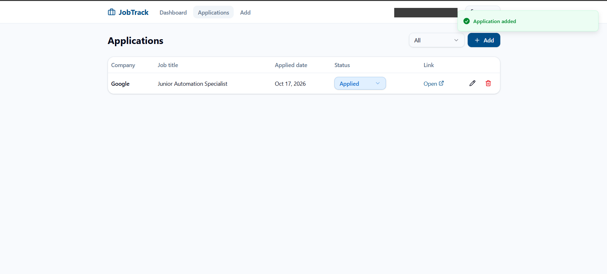
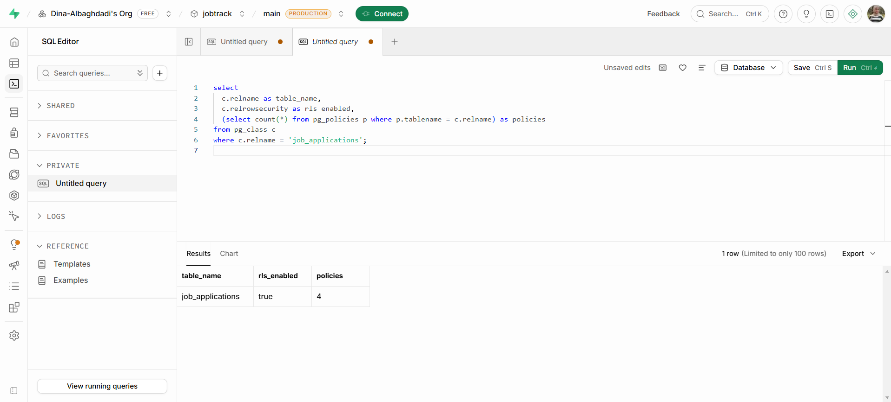
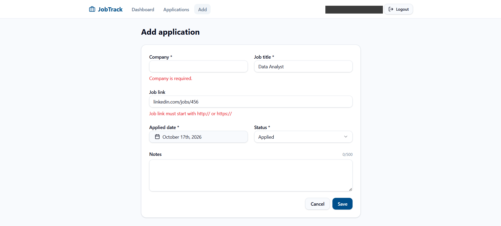
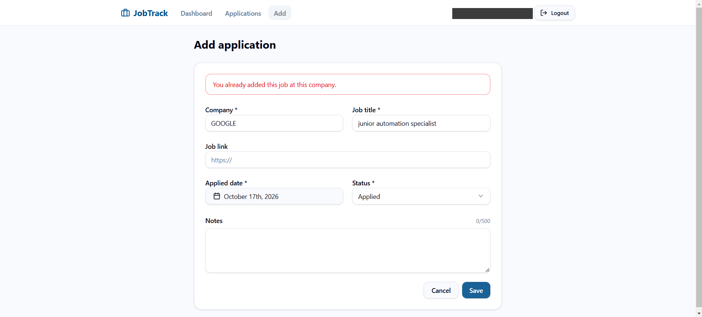
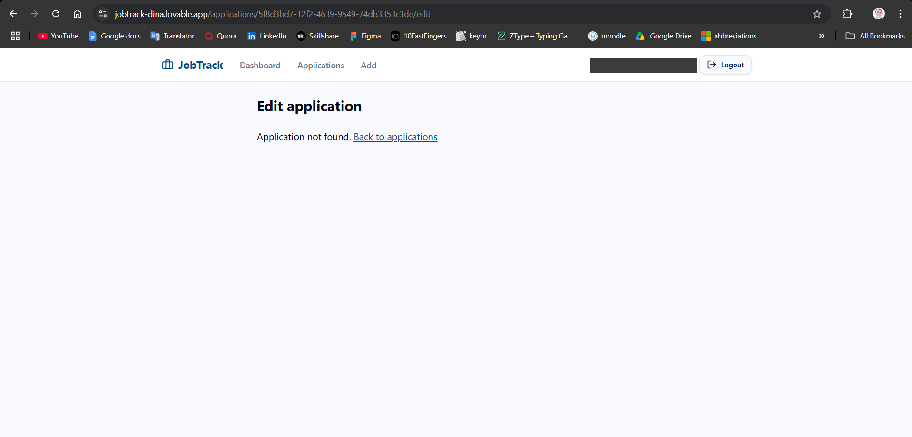
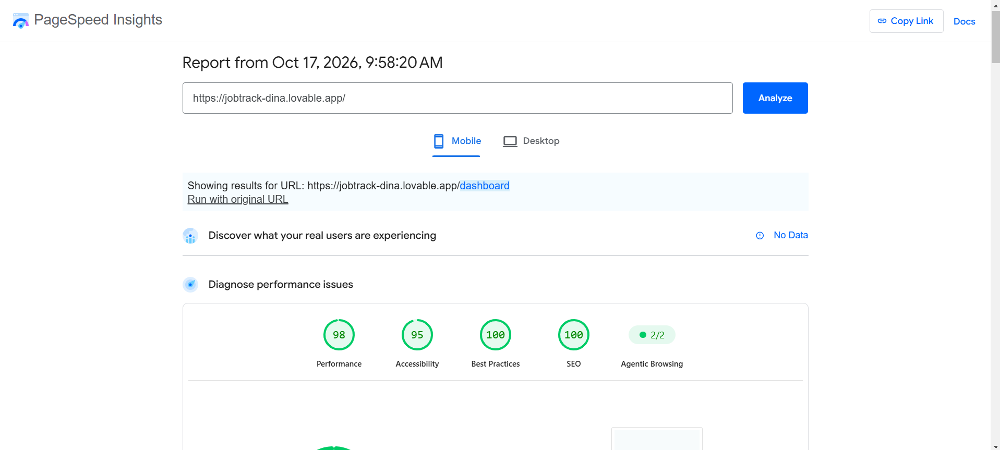

# JobTrack — Job Application Tracker

> A web app where job seekers track their applications (company, job, date, status) in a private account that no one else can see.

**🌐 English** · [العربية](#-النسخة-العربية)

---

## 🎯 Problem

### The Context

Job seekers — especially recent graduates — apply to many jobs through different sources: LinkedIn, company websites, and email. They usually track these applications in their head or in scattered notes.

### The Problem

After a few weeks they forget where they applied, when, and what stage each application reached. They apply to the same job twice, miss an interview follow-up, and cannot tell how many applications moved forward.

### Why It Matters

Job searching is long and tiring. One clear record saves time, prevents embarrassing mistakes such as duplicate applications, and gives a realistic picture of progress. Because the data is personal, it must stay private to its owner.

---

## 💡 Solution

A web app built with **Lovable** and connected to **Supabase** for the database and authentication.

What does the system do?

1. Lets the user sign up (with email confirmation), log in, and log out.
2. Lets the user add an application, with validation: required fields, a valid link format, and no future date.
3. Prevents adding the same company and job twice, even with different letter case or extra spaces.
4. Shows the list of applications and a summary by status (`Applied`, `Interview`, `Offer`, `Rejected`), with status update and delete.
5. Ensures each user sees and edits **only their own applications** through Row Level Security in Supabase.



---

## 👤 Users

**Primary Users:**  
A graduate or job seeker tracking their own applications.

**User Need:**  
Record every application in one place, know its current status, avoid duplicates, and be sure no one else can see the data.

---

## 🧠 How I Designed the Solution

I designed before building: the table and its fields, the validation rules, the access rules, and the tests that would prove the system works.

Then I split the responsibility:

- **Supabase** owns data and protection: the table, constraints (`CHECK`, `UNIQUE`), and RLS were written directly in SQL.
- **Lovable** owns the interface: pages, the form, and clear error messages.

Validation exists in two layers: the interface gives a clear message, and the database is the last line of protection if the interface is bypassed.

---

## ⚙️ How It Works

```text
User signs in (Supabase Auth)
  ↓
Fills in the application form
  ↓
Logic (interface): required fields, trimming spaces
  ↓
Logic (database): CHECK + UNIQUE + RLS (auth.uid() = user_id)
  ↓
Saved, or a clear error (e.g. "You already added this job at this company.")
  ↓
Output: the user's own list and status summary only
```



---

## 🤖 Role of AI

What does AI do in this solution?

- **Lovable (AI)** generated the whole interface from one detailed prompt: pages, form, validation, and error messages.
- It connected the interface to the existing Supabase table and turned database errors (such as the duplicate code `23505`) into clear messages.

The app itself does not use AI at runtime; it is a data system with fixed rules.

### What AI Should NOT Do

- Create or change the database and RLS automatically. I explicitly told Lovable not to change the database, because protection must be written and reviewed.
- Be trusted when it says something "works". Every function was proven with a test and a screenshot.

---

## 🔄 Automation

What parts of the process are automated?

- Sending the account confirmation email on sign-up (Supabase Auth).
- Linking every application to its owner (`user_id` defaults to `auth.uid()`).
- Validating input, preventing duplicates, and rejecting invalid data.
- Calculating the status summary on the dashboard.
- Isolating each user's data through RLS.
- Deploying to a public link through Lovable.

---

## 🗂️ Data

### Input

- Account: email and password.
- Application: company, job title, job link (optional), applied date, status, notes (optional).

### Output

- A row in the `job_applications` table linked to the user.
- The list of applications, with a status filter.
- A summary: Total, Applied, Interview, Offer, Rejected.
- Clear validation and error messages for invalid input.

---

## 🛠️ Tools & Technologies

| Tool | Purpose |
|---|---|
| Lovable | Interface, pages, functions, and deployment |
| Supabase Database | `job_applications` table and constraints (`CHECK`, `UNIQUE INDEX`) |
| Supabase Auth | Sign up with email confirmation, login, logout |
| Supabase RLS | Each user reads and edits only their own data (4 policies) |
| PageSpeed Insights | Performance and accessibility test (mobile) |

---

## 🔑 Key Design Decisions

### Decision 1

**Decision:**  
Create the database, constraints, and RLS directly in Supabase with SQL; Lovable builds only the interface.

**Why:**  
Protection and rules must be precise and reviewed, not generated by AI. Also, the free Lovable plan had only 5 credits, and writing SQL in Supabase does not use them — the whole app was built with one Lovable message.

### Decision 2

**Decision:**  
Validate in two layers: the interface (clear messages) and the database (`CHECK`, `UNIQUE`, RLS).

**Why:**  
Interface validation alone can be bypassed by calling Supabase directly; the database is the last protection. Duplicate prevention uses `lower(trim(...))`, so `GOOGLE` and `Google` are the same company.

### Decision 3

**Decision:**  
Keep **Confirm email** on, and test both accounts with real email addresses.

**Why:**  
It is closer to a real app, safer, and proves the full sign-up flow works.

---

## 🧪 Testing

### Test 1 — Positive

**Input:**  
User A adds a valid application: `Google` / `Junior Automation Specialist` / `https://careers.google.com/jobs/123` / today / `Applied`.

**Expected Result:**  
A success message; the application appears in the list; dashboard Total = 1 and Applied = 1; a new row in Supabase with `user_id` filled.

**Actual Result:**  
**Application added** appeared, the application was listed, the dashboard showed Total = 1 and Applied = 1, and Supabase had 1 record with `user_id` filled.

**Status:** ✅

---

### Test 2 — Negative

**Input:**  
Empty company, job title `Data Analyst`, job link `linkedin.com/jobs/456` (without `https://`).

**Expected Result:**  
`Company is required.` and `Job link must start with http:// or https://`; nothing is saved.

**Actual Result:**  
Both messages appeared as expected, and the database still had 1 record.

**Status:** ✅



---

### Test 3 — Edge Case

**Input:**  
The same application written differently: company `  GOOGLE  ` (capitals and spaces), job title `junior automation specialist`.

**Expected Result:**  
`You already added this job at this company.`; no new row is saved.

**Actual Result:**  
The message appeared, the spaces were trimmed, and the database still had 1 record.

**Status:** ✅



---

### Test 4 — Data / Access

**Input:**  
User B (a second account with a different email) signs in, then opens User A's edit link directly:  
`/applications/5f8d3bd7-12f2-4639-9549-74db3353c3de/edit`

**Expected Result:**  
User B sees an empty dashboard, and none of User A's data appears, even through the direct link.

**Actual Result:**  
User B's dashboard showed Total = 0. The direct link showed `Application not found.` with no data from User A — RLS blocked the data in the database itself.

**Status:** ✅



---

### Test 5 — Performance (PageSpeed Insights, Mobile)

**Input:**  
`https://jobtrack-dina.lovable.app/`

**Expected Result:**  
Scores in the green range (90–100), and any issues recorded.

**Actual Result:**  
Performance **98**, Accessibility **95**, Best Practices **100**, SEO **100**. FCP 1.1 s, LCP 2.3 s, TBT 0 ms, CLS 0.  
Note: PageSpeed visits the site without signing in, so the result measures the login page only.

**Status:** ✅ (with accessibility notes in Challenges)



---

## 📸 Evidence

### Final Result


### Workflow


### All Evidence

> The email address is hidden in every screenshot.

| # | What it proves | Screenshot |
|---|---|---|
| EV-01 | The Supabase project `jobtrack` is running | [EV-01](./Screenshots/EV-01-supabase-project.png) |
| EV-02 | Lovable is connected to the Supabase project | [EV-02](./Screenshots/EV-02-lovable-supabase-connected.png) |
| EV-03 | The table was created with SQL | [EV-03](./Screenshots/EV-03-sql-table-created.png) |
| EV-04 | RLS enabled with 4 policies | [EV-04](./Screenshots/EV-04-rls-enabled-4-policies.png) |
| EV-05 | Sign up, email confirmation, and login work | [EV-05](./Screenshots/EV-05-login-success-dashboard.png) |
| EV-06 | Test 1: the form before saving | [EV-06](./Screenshots/EV-06-t1-add-form.png) |
| EV-07 | Test 1: success message and the listed application | [EV-07](./Screenshots/EV-07-t1-application-added.png) |
| EV-08 | Test 1: dashboard counts | [EV-08](./Screenshots/EV-08-t1-dashboard-count.png) |
| EV-09 | Test 1: the Supabase row with `user_id` | [EV-09](./Screenshots/EV-09-t1-supabase-row.png) |
| EV-10 | Test 2: error messages | [EV-10](./Screenshots/EV-10-t2-validation-errors.png) |
| EV-11 | Test 2: database still has 1 record | [EV-11](./Screenshots/EV-11-t2-supabase-still-1-record.png) |
| EV-12 | Test 3: duplicate message | [EV-12](./Screenshots/EV-12-t3-duplicate-message.png) |
| EV-13 | Test 3: database still has 1 record | [EV-13](./Screenshots/EV-13-t3-supabase-still-1-record.png) |
| EV-14 | Test 4: User B confirmation email | [EV-14](./Screenshots/EV-14-t4-user-b-confirm-email.png) |
| EV-15 | Test 4: User B's dashboard is empty | [EV-15](./Screenshots/EV-15-t4-user-b-sees-nothing.png) |
| EV-16 | Test 4: User A's direct link → `Application not found.` | [EV-16](./Screenshots/EV-16-t4-direct-url-blocked.png) |
| EV-17 | Test 5: PageSpeed scores (mobile) | [EV-17](./Screenshots/EV-17-pagespeed-mobile-scores.png) |
| EV-18 | Test 5: performance metrics | [EV-18](./Screenshots/EV-18-pagespeed-performance-metrics.png) |
| EV-19 | Test 5: diagnostics | [EV-19](./Screenshots/EV-19-pagespeed-diagnostics.png) |

---

## ⚠️ Challenges & Failures

What didn't work as expected?

- **Limited Lovable credits:** only 5 credits, so there was no room to rebuild several times.
- **An invalid test attempt:** the first try of Test 4 pasted a whole table row instead of the `id`, so a 404 appeared because of a wrong URL — not because of the protection.
- **Accessibility = 95:** PageSpeed found two issues — weak color contrast on the unselected **Sign up** tab, and no `<main>` element on the page.
- **Sign-up with an existing email:** shows `Check your email to confirm your account.` instead of `Email already registered`.

How did I solve it?

- Wrote the database and RLS in SQL in Supabase and one detailed prompt for the interface, so the app was built with one message.
- Did not accept the 404 as evidence; re-ran the test with the correct link and got `Application not found.` (EV-16).
- The accessibility issues and the sign-up message are **recorded as bugs; the fix is in progress**, followed by a re-test.

---

## 📚 What I Learned

### Technical Lesson

Real data protection lives in the database (RLS), not in hiding buttons in the interface. This was proven when User B opened User A's link directly and got no data.

### Problem-Solving Lesson

"Don't assume it works — test it." Even a result that looks like a pass (a 404 page) can come from the wrong cause. The test itself must be checked before its result is trusted.

### AI Lesson

AI builds an interface very fast when the prompt is precise, but it can miss details (color contrast, the existing-email message). Reviewing and testing is my responsibility.

---

## 🔮 Future Improvements

If I continued developing this project, I would:

- Fix the accessibility and existing-email issues, then re-test until Accessibility = 100.
- Add an email reminder for applications whose status has not changed for a while.
- Add search and CSV export.
- Add `Assessment` or `Withdrawn` statuses.

---

## 🔗 Project Links

**Live Demo:** [jobtrack-dina.lovable.app](https://jobtrack-dina.lovable.app/)

**Workflow:** —

**Repository:** —

---

## 👩‍💻 Author

**Dina Albaghdadi**

[LinkedIn](https://www.linkedin.com/in/dina-albaghdadi-79bb9a25a/) · [GitHub](https://github.com/Dina-Albaghdadi)

---
---

<div dir="rtl">

## 🌍 النسخة العربية

> تطبيق ويب يتابع فيه الباحث عن عمل طلبات التوظيف الخاصة به (الشركة، والوظيفة، والتاريخ، والحالة)، بحساب خاص لا يرى بياناته فيه أحد غيره.

> الصور موجودة في النسخة الإنجليزية أعلاه.

### 🎯 المشكلة

الباحث عن عمل، وخاصة الخريج الجديد، يقدّم على وظائف كثيرة عبر مصادر مختلفة، ويتابعها في ذاكرته أو ملاحظات متفرقة. بعد أسابيع ينسى أين قدّم ومتى وإلى أي مرحلة وصل، فيقدّم على نفس الوظيفة مرتين أو يفوّت متابعة مقابلة. ولأن البيانات شخصية، يجب أن تبقى خاصة بصاحبها.

### 💡 الحل

تطبيق مبني بـ**Lovable** ومتصل بـ**Supabase**: تسجيل حساب مع تأكيد البريد، وإضافة طلب مع التحقق من المدخلات، ومنع التكرار حتى مع اختلاف الأحرف والمسافات، وقائمة الطلبات مع ملخص حسب الحالة، وعزل بيانات كل مستخدم عبر RLS.

### 🧠 كيف صممت الحل

صممت قبل البناء: الجدول والحقول، وقواعد التحقق، والصلاحيات، والاختبارات. Supabase مسؤول عن البيانات والحماية (كتبتها بـSQL)، وLovable مسؤول عن الواجهة. والتحقق في طبقتين: الواجهة تعطي رسالة واضحة، وقاعدة البيانات هي الحماية الأخيرة.

### 🔑 قرارات التصميم

1. **قاعدة البيانات والـRLS بـSQL مباشرة**، وLovable للواجهة فقط، لأن الحماية يجب أن تكون مكتوبة ومراجَعة، ولتوفير الـCredits.
2. **التحقق في طبقتين** لأن تحقق الواجهة وحده يمكن تجاوزه.
3. **إبقاء تأكيد البريد مفعّلًا** واختبار الحسابين ببريدين حقيقيين.

### 🧪 الاختبارات

- **إيجابي:** إضافة طلب صحيح، فظهرت رسالة النجاح وحُفظ الصف مع `user_id` ✅
- **سلبي:** شركة فارغة ورابط بدون `https://`، فظهرت رسالتا الخطأ ولم يُحفظ شيء ✅
- **حالة حدّية:** نفس الطلب بأحرف كبيرة ومسافات، فظهرت رسالة التكرار ✅
- **الوصول للبيانات:** المستخدم B فتح رابط طلب المستخدم A مباشرة، فظهر *Application not found* بدون أي بيانات ✅
- **الأداء:** Performance 98، وAccessibility 95، وBest Practices 100، وSEO 100 ✅

### ⚠️ التحديات وكيف حللتها

- رصيد Lovable محدود (5 credits)، فبنيت التطبيق برسالة واحدة مفصّلة.
- أول محاولة لاختبار الوصول أظهرت 404 بسبب رابط خاطئ، فلم أعتمدها وأعدت الاختبار بالرابط الصحيح.
- مشكلتا Accessibility ورسالة التسجيل ببريد مسجّل: سُجّلتا كـBugs، والإصلاح وإعادة الاختبار قيد التنفيذ.

### 📚 ماذا تعلمت

- **تقنيًا:** الحماية الحقيقية في قاعدة البيانات (RLS)، وليس في إخفاء الأزرار.
- **حل المشكلات:** يجب التحقق من صحة الاختبار نفسه قبل اعتماد نتيجته.
- **الذكاء الاصطناعي:** الـAI سريع في بناء الواجهة عندما يكون الـPrompt دقيقًا، لكن المراجعة والاختبار مسؤوليتي.

</div>
