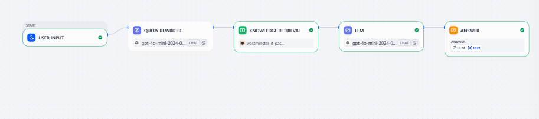
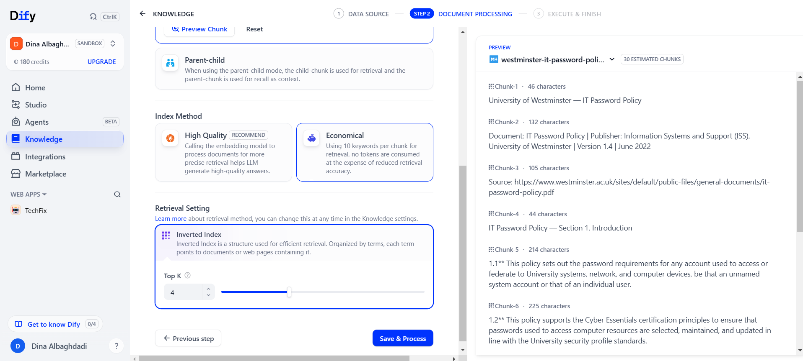
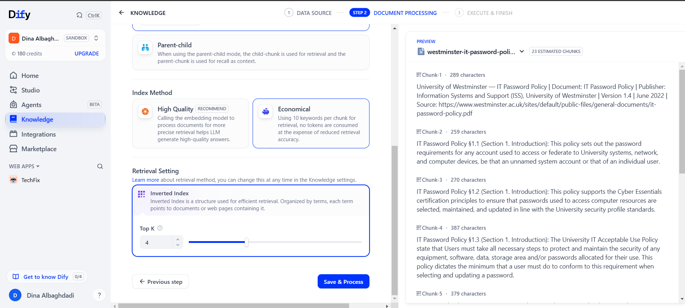
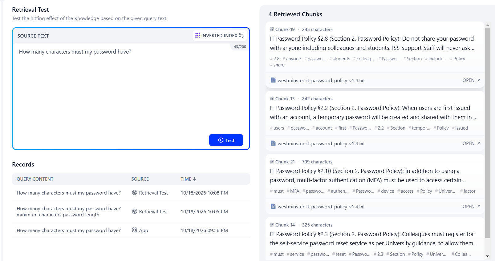
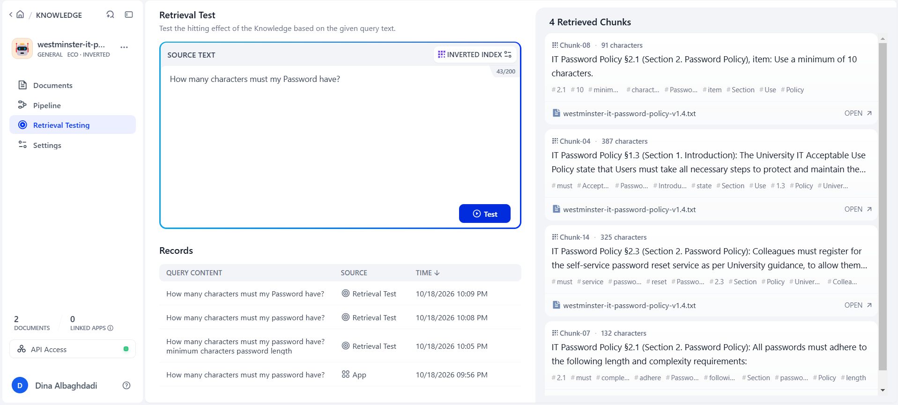
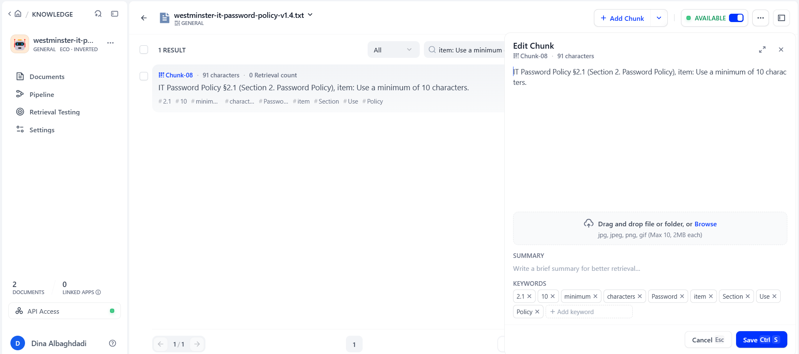

# PolicyBot — Knowledge-Grounded IT Policy Assistant (Dify)

> A RAG assistant that answers staff and student questions about IT policies only from the official policy documents, cites the exact clause, and says so when the documents do not contain the answer.

**🌐 English** · [العربية](#-النسخة-العربية)

> **Status: in progress.** Knowledge design, build, Round 1 evaluation, and failure analysis are complete. Round 2 (re-testing after the improvements) is not finished yet.



---

## 🎯 Problem

### The Context

IT policies are published as long PDFs (3,800+ words) that most staff and students never read.

### The Problem

The same questions keep reaching the service desk — *How long must my password be? Can I use ChatGPT for university data?* — and people break rules they did not know about.

### Why It Matters

Fast, correct answers with the exact clause as evidence reduce repeated questions and accidental policy violations.

---

## 💡 Solution

A Dify Chatflow grounded in two official, public policies:

| Source | Version |
|---|---|
| [University of Westminster — IT Acceptable Use Policy](https://westminster.ac.uk/sites/default/public-files/general-documents/IT-acceptable-use-policy-v4.4.pdf) | v4.4, Nov 2024 |
| [University of Westminster — IT Password Policy](https://www.westminster.ac.uk/sites/default/public-files/general-documents/it-password-policy.pdf) | v1.4, Jun 2022 |

What does the system do?

1. Rewrites the question into search keywords.
2. Retrieves the matching policy clauses.
3. Answers only from them, citing the clause (for example *IT Password Policy §2.1*).
4. Says clearly when the documents do not contain the answer.

---

## 👤 Users

**Primary Users:**  
University staff and students, and the service desk team.

**User Need:**  
A correct answer about an IT rule, with the source, in seconds.

---

## 🧠 How I Designed the Solution

- **Knowledge first:** reviewed both documents and fixed ten quality issues before indexing (page footers inside clauses, duplicated numbering, merged bullet lists).
- **One clause per chunk:** every chunk starts with its document, clause number, and section, so it can be cited on its own.
- **Measure before improving:** a 13-question test set with expected answers written before testing.

| Chunking v1 (rejected) | Chunking v2 (used) |
|---|---|
|  |  |

---

## ⚙️ How It Works

```text
User question
  ↓
Query Rewriter (LLM)
  ↓
Knowledge Retrieval
  ↓
LLM (answer only from context, cite §clause, or say "not enough information")
  ↓
Answer + citations
```

---

## 🤖 Role of AI

What does AI do in this solution?

- Rewrites the question into effective search keywords.
- Writes the answer from the retrieved clauses, with citations.

### What AI Should NOT Do

- Use knowledge outside the two policies.
- Invent numbers, dates, links, or the content of policies that are only referenced (BYOD, Patching, Safe Use of AI).

---

## 🔄 Automation

What parts of the process are automated?

- Question rewriting, retrieval, grounded generation, and citations for every question.

---

## 🗂️ Data

### Input

A question in English or Arabic.

### Output

An answer with the policy clause cited, a partial answer stating what is missing, or a clear "not enough information" with the service desk link.

---

## 🛠️ Tools & Technologies

| Tool | Purpose |
|---|---|
| Dify (Chatflow, Knowledge, Retrieval Testing) | Pipeline and evaluation |
| GPT-4o mini, then Gemini (own API key) | Query rewriting and answers |
| text-embedding-3-small | Semantic retrieval (after improvement I5) |

---

## 🔑 Key Design Decisions

### Decision 1

**Decision:**  
Rewrite the documents so every clause is a self-contained chunk.

**Why:**  
The first chunking preview showed headings as empty chunks and clauses without their document name, so answers could not be cited.

### Decision 2

**Decision:**  
Start with keyword (Economical) indexing, and move to High Quality + Hybrid only when the tests proved it necessary.

**Why:**  
Save tokens first, and change the configuration based on evidence, not assumptions.

---

## 🧪 Testing

13 questions covering clear, distributed, indirect, unanswerable, partial, misleading, Arabic, and prompt-injection cases.

**Round 1 baseline: 5 / 13 correct, no invented answers in single-question runs.**

The key finding: two questions gave the same refusal for **different** reasons.

| | TC01 — password length | TC08 — MFA |
|---|---|---|
| Answer clause in the context? | ❌ No | ✅ Yes, ranked first |
| Stage that failed | Retrieval | Generation (prompt made the model over-refuse) |

Changing **one letter** proved the retrieval cause — keyword search was case-sensitive:

| `…my password have?` — not retrieved | `…my Password have?` — ranked first |
|---|---|
|  |  |

Full results: [evaluation report](https://github.com/Dina-Albaghdadi/PolicyBot-Dify/blob/main/docs/05-evaluation-improvement.md).

---

## 📸 Evidence

### Final Result



### Workflow


---

## ⚠️ Challenges & Failures

What didn't work as expected?

- Keyword retrieval missed answers because of letter case, singular/plural forms, synonyms (*Wi-Fi router* vs *wireless access points*), and Arabic questions against English documents.
- The model refused even when the right clause was retrieved (TC08).
- Answers changed depending on the conversation history.
- One early "success" came from a run where the improvement was not actually connected, so it was discarded.

How did I solve it?

- I1 Query Rewriter, I2 prompt v2 (partial answers before refusal), I3 memory off, I4 Top K 4 → 8, I5 High Quality + Hybrid search.
- Round 2 is not complete yet: the hosted model provider returned errors during re-testing.

---

## 📚 What I Learned

### Technical Lesson

Chunk shape decides what the model can retrieve and cite; keyword and semantic search fail in different ways.

### Problem-Solving Lesson

A refusal can hide two different failures. Checking what was retrieved is the only way to tell retrieval from generation.

### AI Lesson

A test result is only valid if the change being tested is really wired in.

---

## 🔮 Future Improvements

- Complete Round 2 on all 13 questions and compare with the baseline.
- Add more policies referenced by the current ones (BYOD, Patching, Safe Use of AI).

---

## 🔗 Project Links

**Live Demo:** —

**Workflow:** Dify Chatflow (shown above)

**Repository:** [PolicyBot-Dify](https://github.com/Dina-Albaghdadi/PolicyBot-Dify)

---

## 👩‍💻 Author

**Dina Albaghdadi**

[LinkedIn](https://www.linkedin.com/in/dina-albaghdadi-79bb9a25a/) · [GitHub](https://github.com/Dina-Albaghdadi)

---
---

<div dir="rtl">

## 🌍 النسخة العربية

> مساعد RAG يجيب عن أسئلة الموظفين والطلاب حول سياسات تقنية المعلومات من الوثائق الرسمية فقط، ويذكر رقم البند، ويصرّح عندما لا تحتوي الوثائق على الإجابة.

> **الحالة: قيد التنفيذ.** الجولة الثانية من الاختبار لم تكتمل بعد.

### 🎯 المشكلة

سياسات IT مكتوبة في ملفات PDF طويلة لا يقرؤها أحد، فتتكرر الأسئلة على مكتب الدعم وتحدث مخالفات غير مقصودة.

### 💡 الحل

Chatflow في Dify يعيد صياغة السؤال، ويسترجع بنود السياستين الرسميتين، ويجيب منها فقط مع ذكر البند.

### 🧪 الاختبارات

13 سؤالًا بأنواع مختلفة. النتيجة الأولى: 5 من 13 صحيحة بدون أي إجابة مخترعة. وأهم اكتشاف أن سؤالين أعطيا نفس الرفض لسببين مختلفين: مشكلة استرجاع ومشكلة توليد، وأن البحث بالكلمات حساس لحالة الأحرف.

### 🛠️ التحسينات

إعادة صياغة السؤال، وتعليمات تفضّل الإجابة الجزئية، وإيقاف الذاكرة، ورفع Top K، والانتقال إلى البحث بالمعنى.

### 📚 ماذا تعلمت

الرفض قد يخفي فشلين مختلفين، والطريقة الوحيدة للتمييز بينهما هي فحص ما تم استرجاعه.

</div>
