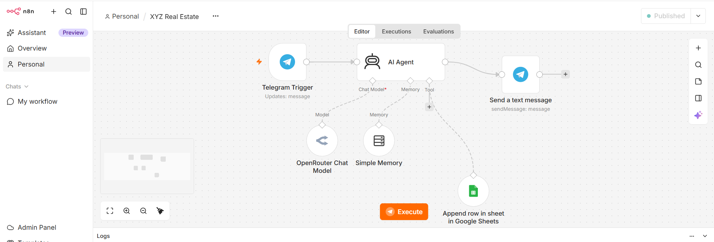
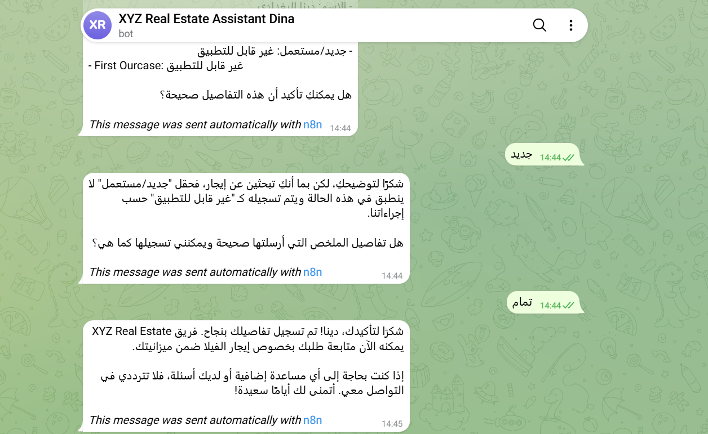

# XYZ Real Estate — AI Agent (n8n + Telegram)

> A Telegram AI agent that welcomes real-estate customers, collects their requirements one question at a time, confirms the summary, and only then saves the lead to Google Sheets.

**🌐 English** · [العربية](#-النسخة-العربية)



---

## 🎯 Problem

### The Context

A real-estate company receives customer messages that mention needs in a scattered way: some details in one message, others missing.

### The Problem

Someone has to ask follow-up questions, apply business rules (rent vs buy, budget ranges), and record the lead correctly — and a lead saved before the customer confirms can be wrong.

### Why It Matters

Leads must be complete, correct, and confirmed before the sales team uses them.

---

## 💡 Solution

An n8n AI agent connected to Telegram:

1. Welcomes the customer once.
2. Collects nine fields one question at a time: property type, buy/rent, new/resale, first purchase, timeline, budget, name, email, phone.
3. Applies business rules (rent → *New/Resale* and *First Purchase* = *Not Applicable*; budget mapped to exact ranges).
4. Shows a summary and saves to Google Sheets **only after explicit confirmation**.

---

## 👤 Users

**Primary Users:**  
Customers looking to buy or rent a property, and the sales team that follows up.

**User Need:**  
Customers: a quick, friendly conversation. Team: complete, confirmed leads in one sheet.

---

## 🧠 How I Designed the Solution

**Collect → validate → confirm → execute.** The agent decides what to ask next, but saving is allowed only after the customer confirms the final summary.

---

## ⚙️ How It Works

```text
Telegram Trigger
  ↓
AI Agent
   ├─ Chat model (OpenRouter)
   ├─ Simple Memory (session = Telegram chat id)
   └─ Google Sheets Tool (append row)
  ↓
Telegram Send Message
```

---

## 🤖 Role of AI

What does AI do in this solution?

- Understands free-text messages and extracts several details from one message.
- Decides the next missing question.
- Maps answers to allowed values (for example, a budget to its exact range).

### What AI Should NOT Do

- Guess or invent customer details.
- Save before explicit confirmation, or claim success if the tool failed.
- Add columns or fields beyond the nine required ones.

---

## 🔄 Automation

What parts of the process are automated?

- The full conversation, rule application, summary, and saving the confirmed lead.

---

## 🗂️ Data

### Input

Customer messages on Telegram.

### Output

One row in the **Leads** sheet with exactly nine columns.

---

## 🛠️ Tools & Technologies

| Tool | Purpose |
|---|---|
| n8n | Workflow and AI Agent |
| Telegram | Customer interface |
| OpenRouter | Chat model |
| Simple Memory | Conversation context |
| Google Sheets | Confirmed leads |

---

## 🔑 Key Design Decisions

### Decision 1

**Decision:**  
Save only after an explicit confirmation of the full summary.

**Why:**  
Complete information is not the same as approved information.

### Decision 2

**Decision:**  
Session ID = Telegram chat id.

**Why:**  
Each customer keeps their own conversation context; customers never share memory.

---

## 🧪 Testing

### Test 1 — Rent request: rule applied, then confirmation before saving

**Input:**  
A rental request for a villa. At the summary step, the customer answered *"new"* to a field that does not apply to rentals, then confirmed.

**Expected Result:**  
For rentals, *New/Resale* and *First Purchase* stay *Not Applicable*; the agent explains this instead of accepting the answer, asks for confirmation again, and saves only after the customer confirms.

**Actual Result:**  
The agent explained that *New/Resale* does not apply to rentals and is recorded as *Not Applicable*, asked to confirm the summary again, and only after *"تمام"* replied that the details were recorded successfully.

**Status:** ✅



> More tests (buy request, missing information, invalid email, correction, no confirmation, duplicate) will be added.

---

## 📸 Evidence

### Final Result


### Workflow


---

## ⚠️ Challenges & Failures

> Will be documented with the test results.

---

## 📚 What I Learned

### Technical Lesson

How an AI agent uses a chat model, memory, and a tool inside one n8n workflow.

### Problem-Solving Lesson

The system message alone cannot guarantee that an action waits for confirmation; the design must enforce it.

### AI Lesson

An agent is a system that decides and acts, so it needs clear boundaries.

---

## 🔗 Project Links

**Live Demo:** Telegram bot (private)

**Workflow:** n8n — *XYZ Real Estate* (published; shown above)

**Repository:** —

---

## 👩‍💻 Author

**Dina Albaghdadi**

[LinkedIn](https://www.linkedin.com/in/dina-albaghdadi-79bb9a25a/) · [GitHub](https://github.com/Dina-Albaghdadi)

---
---

<div dir="rtl">

## 🌍 النسخة العربية

> AI Agent على تيليجرام يرحّب بعملاء شركة عقارات، ويجمع متطلباتهم سؤالًا سؤالًا، ويعرض ملخصًا، ولا يحفظ البيانات في Google Sheets إلا بعد تأكيد العميل.

### 💡 الحل

يجمع تسعة حقول، ويطبق قواعد العمل (الإيجار يجعل حقلي الجديد/المستعمل وأول شراء "غير منطبق"، والميزانية تُصنّف ضمن فئات محددة)، ويحفظ فقط بعد التأكيد الصريح.

### 🔑 قرارات التصميم

1. **الحفظ بعد التأكيد الصريح فقط**، لأن اكتمال البيانات لا يعني الموافقة عليها.
2. **رقم المحادثة كمعرّف للجلسة** حتى لا تختلط ذاكرة العملاء.

### 🧪 الاختبارات

ستُضاف النتائج والصور.

</div>
