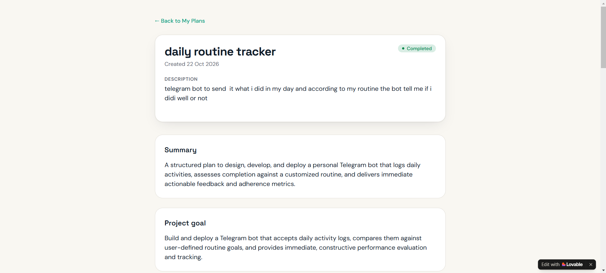
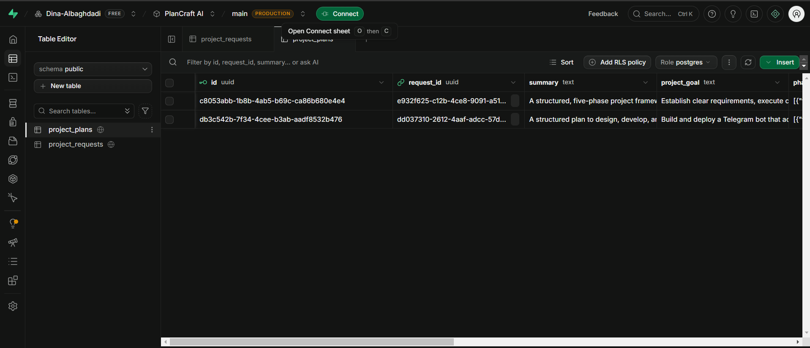
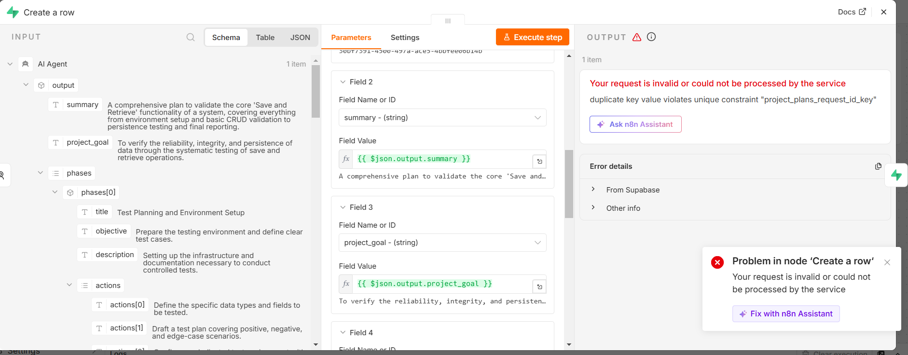

# PlanCraft AI — AI Project Planner (Lovable + n8n + Supabase)

> A web app where the user describes a project idea, and an n8n workflow with an AI agent turns it into a structured plan — summary, goal, phases, recommended actions, risks, and duration — saved to the database and shown back in the app.

**🌐 English** · [العربية](#-النسخة-العربية)



---

## 🎯 Problem

### The Context

People start projects with an idea but no structured plan: no clear phases, actions, or risks.

### The Problem

Turning an idea into a plan takes time and experience. A single app cannot do it well alone: it needs a place to store requests, an AI to generate the plan, and an orchestrator to connect them reliably.

### Why It Matters

The value is not one tool but **a correct result across system boundaries**: the request must reach the workflow, the AI output must have the right shape, the plan must be saved once, and the user must see the final status.

---

## 💡 Solution

An integrated system with four components:

1. **Lovable app** saves the request in Supabase and sends its `request_id` to an n8n webhook.
2. **n8n** responds immediately (`202 processing`), then reads the request from Supabase.
3. **AI Agent (Gemini)** generates the plan in a fixed JSON shape (Structured Output Parser).
4. **n8n** saves the plan in `project_plans` and updates the request to `completed`; the app shows the plan.


---

## 👤 Users

**Primary Users:**  
Freelancers, students, and early-career professionals planning a new project.

**User Need:**  
Describe an idea once and receive a clear, structured plan they can act on.

---

## 🧠 How I Designed the Solution

Each component has **one responsibility**, and they communicate through a small, explicit contract:

| Component | Responsibility |
|---|---|
| Lovable app | User interface, saving the request, polling the status |
| Supabase | Source of truth: `project_requests` and `project_plans` |
| n8n | Orchestration: receive, read, generate, save, update status |
| Gemini (AI Agent) | Generate the plan in the required structure |

**Data contract (app → n8n):** `POST { "request_id": "<uuid>" }` — only the ID is sent; n8n reads the full request from the database, so the database stays the single source of truth.

---

## ⚙️ How It Works

```text
Lovable app
  │ save request (status = pending)
  │ POST { request_id } → n8n webhook
  ▼
n8n
  Respond 202 (processing)
  → Edit Fields (request_id)
  → Supabase: get request
  → AI Agent + Structured Output Parser
  → Supabase: create project_plans row
  → Supabase: update request status = completed
  ▼
Lovable app polls → shows the completed plan
```

---

## 🤖 Role of AI

What does AI do in this solution?

- Reads the project title, description, goal, and context.
- Returns a plan with a fixed structure: `summary`, `project_goal`, `phases[]`, `recommended_actions[]`, `risks[]`, `estimated_duration`.
- The Structured Output Parser rejects output that does not match the structure.

### What AI Should NOT Do

- Decide the workflow steps or write directly to the database — n8n does that.
- Return free text that the app cannot store or display.
- Be trusted without checking that the plan was actually saved and the status updated.

---

## 🔄 Automation

What parts of the process are automated?

- Receiving every new request through the webhook.
- Reading the request, generating the plan, and saving it.
- Updating the request status so the app knows when the plan is ready.

---

## 🗂️ Data

### Input

`project_requests`: `title`, `description`, `goal`, `additional_context`, `status` ∈ `pending · processing · completed · failed`.

### Output

`project_plans`: `request_id` (**unique**, cascade delete), `summary`, `project_goal`, `phases[]`, `recommended_actions[]`, `risks[]`, `estimated_duration`.



---

## 🛠️ Tools & Technologies

| Tool | Purpose |
|---|---|
| Lovable | The web app (form, plan list, plan page) |
| Supabase | Database with RLS and constraints |
| n8n | Webhook, AI Agent, Structured Output Parser, Supabase nodes |
| Google Gemini | Plan generation |

---

## 🔑 Key Design Decisions

### Decision 1

**Decision:**  
Send only `request_id` to n8n, and let n8n read the request from Supabase.

**Why:**  
The database stays the single source of truth, and the webhook payload stays small and easy to validate.

### Decision 2

**Decision:**  
Respond to the webhook immediately (`202`) and generate the plan in the background.

**Why:**  
AI generation takes time; the user sees *Processing* instead of a frozen page, and the app polls until the status is `completed`.

### Decision 3

**Decision:**  
`request_id` is unique in `project_plans`.

**Why:**  
If the same request is processed twice, the database rejects the second plan instead of creating a duplicate.

---

## 🧪 Testing

### Test 1 — End-to-end request from the app

**Input:**  
A new request from the app: *daily routine tracker* — a Telegram bot that compares what I did with my routine.

**Expected Result:**  
Status changes from *Processing* to *Completed*; the plan appears with summary, goal, phases, actions, and risks; a row exists in `project_plans` with the same `request_id`.

**Actual Result:**  
The request completed, the plan was shown in the app, the n8n execution succeeded, and the plan row was saved in Supabase.

**Status:** ✅

---

### Test 2 — Same request processed twice

**Input:**  
The same `request_id` sent to the workflow a second time.

**Expected Result:**  
No duplicate plan.

**Actual Result:**  
Supabase rejected the insert: `duplicate key value violates unique constraint "project_plans_request_id_key"`.

**Status:** ✅



---

## 📸 Evidence

### Final Result


### Workflow


---

## ⚠️ Challenges & Failures

What didn't work as expected?

- The app showed `Missing Supabase environment variable(s)`: the project was a remix, which copies code but not the database connection or secrets, and the `SUPABASE_` prefix is reserved for secret names.
- The AI step failed with `404`: the chosen Gemini model was retired for new API projects.
- Real requests failed with `invalid input syntax for type uuid: "null"`: manual tests sent `id`, but the app sends `request_id`.
- After fixing it, the same error came back because of a hidden newline at the end of the expression.
- Test runs in the editor passed while real requests failed: the changes were saved but not published.

How did I solve it?

- Added the connection as `EXTERNAL_SUPABASE_URL` and `EXTERNAL_SUPABASE_SERVICE_ROLE_KEY` (server-side only).
- Switched to an available Gemini model.
- Read `body.request_id` (with `id` as fallback) and added `.trim()`.
- Published every change and verified real runs in *Executions*.

| Test runs ✅ vs real runs ❌ | The null `request_id` |
|---|---|
|  |  |

---

## 📚 What I Learned

### Technical Lesson

How a webhook, an asynchronous workflow, an AI agent with structured output, and database constraints work together — and that saving a workflow is not the same as publishing it.

### Problem-Solving Lesson

A test is only meaningful if it uses the same data shape as the real system. Opening the real request body in *Executions* found the bug that every manual test missed.

### AI Lesson

The AI is one step in the system, not the system. Its output must be structured, validated, saved, and confirmed by the rest of the workflow.

---

## 🔮 Future Improvements

If I continued developing this project, I would:

- Set the request status to `failed` with a clear message when any workflow step fails.
- Retry the AI step automatically on temporary model errors.
- Let the user edit and regenerate a plan.

---

## 🔗 Project Links

**Live Demo:** [projects-plan-craft-ai.lovable.app](https://projects-plan-craft-ai.lovable.app)

**Workflow:** n8n — *PlanCraft AI — Generate Project Plan* (private workspace; shown above)

**Repository:** [projects-plan-craft-ai](https://github.com/Dina-Albaghdadi/projects-plan-craft-ai)

---

## 👩‍💻 Author

**Dina Albaghdadi**

[LinkedIn](https://www.linkedin.com/in/dina-albaghdadi-79bb9a25a/) · [GitHub](https://github.com/Dina-Albaghdadi)

---
---

<div dir="rtl">

## 🌍 النسخة العربية

> تطبيق ويب يكتب فيه المستخدم فكرة مشروعه، فيحوّلها Workflow في n8n مع AI Agent إلى خطة منظمة (ملخص، وهدف، ومراحل، وإجراءات، ومخاطر، ومدة)، تُحفظ في قاعدة البيانات وتظهر في التطبيق.

> الصور موجودة في النسخة الإنجليزية أعلاه.

### 🎯 المشكلة

تحويل فكرة إلى خطة يحتاج وقتًا وخبرة، ولا يكفي تطبيق واحد لذلك: نحتاج مكانًا لحفظ الطلبات، وذكاءً اصطناعيًا لتوليد الخطة، ومنسّقًا يربط بينهما بشكل موثوق.

### 💡 الحل

نظام من أربعة أجزاء: تطبيق Lovable يحفظ الطلب ويرسل رقمه إلى n8n، وn8n يرد فورًا ثم يقرأ الطلب ويولّد الخطة بـGemini بشكل JSON ثابت، ويحفظها ويحدّث الحالة إلى مكتمل، والتطبيق يعرض الخطة.

### 🔑 قرارات التصميم

1. **إرسال رقم الطلب فقط**، وn8n يقرأ التفاصيل من قاعدة البيانات، لتبقى المصدر الوحيد للحقيقة.
2. **الرد الفوري ثم المعالجة في الخلفية**، حتى يرى المستخدم *Processing* بدل صفحة متجمدة.
3. **`request_id` فريد** في جدول الخطط، فلا تتكرر الخطة إذا عولج الطلب مرتين.

### 🧪 الاختبارات

- **طلب حقيقي من التطبيق:** تغيرت الحالة إلى مكتمل، وظهرت الخطة، ونجح التنفيذ في n8n، وحُفظ الصف في Supabase ✅
- **نفس الطلب مرتين:** رفضت قاعدة البيانات الخطة المكررة ✅

### ⚠️ التحديات وكيف حللتها

- متغيرات Supabase مفقودة بعد الـRemix، فأضفتها بأسماء جديدة لأن البادئة `SUPABASE_` محجوزة.
- خطأ 404 لأن موديل Gemini أُوقف للمشاريع الجديدة، فاستبدلته.
- رقم الطلب يصل فارغًا لأن الاختبار يرسل `id` والتطبيق يرسل `request_id`، فصار الـWorkflow يقرأ الاثنين، وأضفت `.trim()` لسطر مخفي.
- الاختبارات تنجح والطلبات الحقيقية تفشل لأن التعديلات لم تُنشر، فصرت أنشر وأتحقق من Executions.

### 📚 ماذا تعلمت

- **تقنيًا:** كيف يعمل الـWebhook والـWorkflow غير المتزامن والـAI Agent وقيود قاعدة البيانات معًا، وأن الحفظ لا يعني النشر.
- **حل المشكلات:** الاختبار له معنى فقط إذا استخدم نفس شكل البيانات الحقيقية.
- **الذكاء الاصطناعي:** الـAI خطوة داخل النظام وليس النظام كله.

</div>
