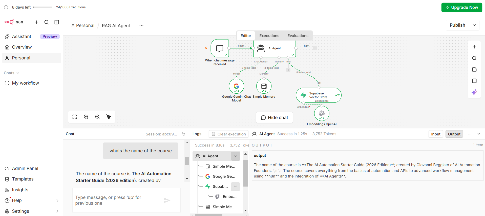
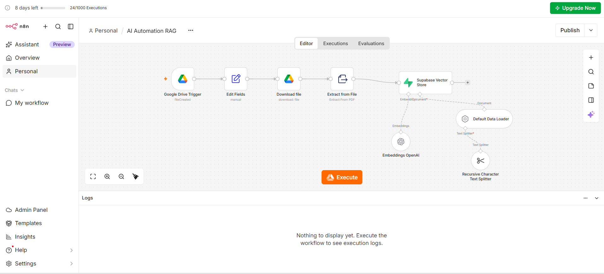

# RAG with n8n — Knowledge Pipeline & RAG AI Agent

> A two-part RAG system built in n8n: a pipeline that turns a PDF into searchable embeddings in Supabase, and an AI agent that answers questions by searching that knowledge first.

**🌐 English** · [العربية](#-النسخة-العربية)



---

## 🎯 Problem

### The Context

In U4, RAG was built with Dify, where most of the steps (extraction, chunking, embeddings, storage, retrieval) happen behind a ready-made interface.

### The Problem

When the steps are hidden, it is hard to understand why an answer is good or bad, or to reuse the same knowledge inside other automations.

### Why It Matters

Building RAG step by step shows exactly where knowledge enters the system, how it is searched, and where a failure can come from — retrieval or generation.

---

## 💡 Solution

Two separate workflows:

1. **Knowledge Ingestion Pipeline** — prepares the knowledge: Google Drive PDF → extract text → split into chunks → embeddings → Supabase Vector Store.
2. **RAG AI Agent** — uses the knowledge: chat message → AI agent → Supabase Vector Store as a tool → relevant chunks → grounded answer.

**Knowledge source:** *AI Automation Starter Guide (2026 Edition)* (PDF).

---

## 👤 Users

**Primary Users:**  
Learners who want to ask questions about the course guide.

**User Need:**  
Get answers that come from the guide itself, not from the model's general knowledge.

---

## 🧠 How I Designed the Solution

The system separates **preparing** knowledge from **using** it:

| Part | Type | Runs when |
|---|---|---|
| Knowledge Ingestion Pipeline | Workflow (not an agent) | A new file is added to the Google Drive folder |
| RAG AI Agent | AI Agent with a retrieval tool | A user sends a chat message |

Supabase (PostgreSQL + `pgvector`) stores the chunks and their embeddings in a `documents` table, with a `match_documents` function for similarity search.

---

## ⚙️ How It Works

### 1. Knowledge Ingestion Pipeline

```text
Google Drive Trigger (file created)
  ↓
Edit Fields → Download file → Extract from File (PDF)
  ↓
Supabase Vector Store (insert)
   ├─ Default Data Loader
   │    └─ Recursive Character Text Splitter (chunking)
   └─ Embeddings OpenAI
```



### 2. RAG AI Agent

```text
When chat message received
  ↓
AI Agent
   ├─ Chat model: Google Gemini
   ├─ Memory: Simple Memory (conversation context)
   └─ Tool: Supabase Vector Store (+ Embeddings OpenAI for the question)
  ↓
Answer grounded in the retrieved chunks
```

---

## 🤖 Role of AI

What does AI do in this solution?

- **Embeddings model** turns each chunk — and each user question — into a vector, so similar meaning can be found by similarity search.
- **Gemini (AI Agent)** decides to call the vector store tool, reads the retrieved chunks, and writes the answer.

### What AI Should NOT Do

- Answer from general knowledge when the guide does not contain the answer.
- Treat memory as knowledge: memory keeps the conversation; the vector store holds the facts.

---

## 🔄 Automation

What parts of the process are automated?

- New PDFs in the Drive folder are ingested automatically: extracted, chunked, embedded, and stored.
- Every question triggers retrieval before generation.

---

## 🗂️ Data

### Input

- **Pipeline:** a PDF file from Google Drive.
- **Agent:** a user's chat question.

### Output

- **Pipeline:** rows in the Supabase `documents` table (chunk text, metadata, embedding vector).
- **Agent:** an answer built from the retrieved chunks.

---

## 🛠️ Tools & Technologies

| Tool | Purpose |
|---|---|
| n8n | Both workflows and the AI agent |
| Google Drive | Source of the knowledge files |
| Supabase + pgvector | Vector store (`documents` table, `match_documents`) |
| OpenAI Embeddings | Vectors for chunks and questions |
| Google Gemini | Chat model of the agent |
| Simple Memory | Conversation context |

---

## 🔑 Key Design Decisions

### Decision 1

**Decision:**  
Split the system into an ingestion pipeline and an agent.

**Why:**  
Preparing knowledge happens once per document; answering happens on every question. Keeping them separate makes each part simpler to test and lets the same knowledge serve other workflows later.

### Decision 2

**Decision:**  
Use the same embeddings model for chunks and questions.

**Why:**  
Similarity search only works if questions and chunks live in the same vector space.

### Decision 3

**Decision:**  
Give the agent the vector store as a **tool**, not as fixed context.

**Why:**  
The agent retrieves only the chunks relevant to each question instead of reading the whole guide.

---

## 🧪 Testing

### Test 1 — Question answered from the knowledge base

**Input:**  
`whats the name of the course`

**Expected Result:**  
The agent calls the Supabase Vector Store tool and answers with the guide's title.

**Actual Result:**  
*"The name of the course is **The AI Automation Starter Guide (2026 Edition)**, created by Giovanni Beggiato of AI Automation Founders…"* — the execution log shows the vector store tool and the embeddings call were used.

**Status:** ✅

---

## 📸 Evidence

### Final Result


### Workflow


---

## ⚠️ Challenges & Failures

What didn't work as expected?

- RAG in Dify hid the pipeline; rebuilding it in n8n required setting up the vector database (pgvector, `documents` table, `match_documents`) before any workflow could run.

How did I solve it?

- Enabled the `vector` extension in Supabase and created the vector store structure, then built and tested the ingestion pipeline before the agent.

---

## 📚 What I Learned

### Technical Lesson

How documents become searchable knowledge: extraction, chunking, embeddings, vector storage, and similarity search — and how an agent uses retrieval as a tool.

### Problem-Solving Lesson

Separating ingestion from answering makes it clear where to look when an answer is wrong: missing or badly chunked knowledge (pipeline) versus a poor answer from good chunks (agent).

### AI Lesson

Knowledge and memory are different: the vector store holds facts; memory only holds the conversation.

---

## 🔮 Future Improvements

If I continued developing this project, I would:

- Add a system message that makes the agent say clearly when the guide does not contain the answer.
- Build a test set of answerable and unanswerable questions, as in U4.
- Avoid duplicate chunks when the same file is uploaded twice.

---

## 🔗 Project Links

**Live Demo:** —

**Workflow:** n8n — *AI Automation RAG* and *RAG AI Agent* (private workspace; shown above)

**Repository:** —

---

## 👩‍💻 Author

**Dina Albaghdadi**

[LinkedIn](https://www.linkedin.com/in/dina-albaghdadi-79bb9a25a/) · [GitHub](https://github.com/Dina-Albaghdadi)

---
---

<div dir="rtl">

## 🌍 النسخة العربية

> نظام RAG من جزأين مبني في n8n: مسار يحوّل ملف PDF إلى Embeddings قابلة للبحث في Supabase، وAI Agent يجيب عن الأسئلة بعد البحث في هذه المعرفة.

> الصور موجودة في النسخة الإنجليزية أعلاه.

### 🎯 المشكلة

في الوحدة الرابعة بنينا RAG بـDify، حيث كانت معظم الخطوات مخفية خلف واجهة جاهزة، فيصعب فهم سبب جودة الإجابة أو ضعفها، أو إعادة استخدام المعرفة داخل أتمتة أخرى.

### 💡 الحل

1. **مسار تجهيز المعرفة:** ملف PDF من Google Drive، ثم استخراج النص، ثم تقسيمه إلى Chunks، ثم Embeddings، ثم التخزين في Supabase.
2. **RAG AI Agent:** رسالة المستخدم، ثم Agent يستخدم Supabase Vector Store كأداة، ثم المقاطع المناسبة، ثم إجابة مستندة إليها.

**مصدر المعرفة:** دليل *AI Automation Starter Guide (2026 Edition)*.

### 🔑 قرارات التصميم

1. **فصل تجهيز المعرفة عن استخدامها**، لأن التجهيز مرة لكل ملف، والإجابة مع كل سؤال.
2. **نفس نموذج الـEmbeddings للمقاطع والأسئلة** حتى يعمل البحث بالتشابه.
3. **قاعدة المعرفة كأداة للـAgent** يسترجع منها ما يناسب كل سؤال فقط.

### 🧪 الاختبارات

- سؤال *"ما اسم الكورس؟"*: استخدم الـAgent أداة البحث وأجاب باسم الدليل من قاعدة المعرفة ✅

### 📚 ماذا تعلمت

- **تقنيًا:** كيف تتحول المستندات إلى معرفة قابلة للبحث، وكيف يستخدم الـAgent الاسترجاع كأداة.
- **حل المشكلات:** فصل التجهيز عن الإجابة يوضح أين نبحث عند الخطأ: في المعرفة أم في الإجابة.
- **الذكاء الاصطناعي:** المعرفة تختلف عن الذاكرة؛ قاعدة المعرفة تحمل الحقائق، والذاكرة تحمل المحادثة فقط.

</div>
