

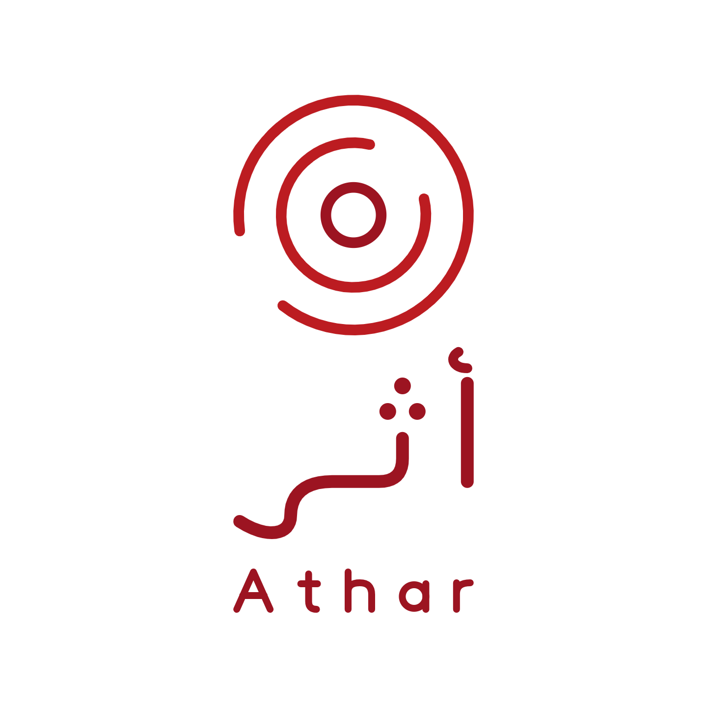

# Athar | أثر — Final Project

**Field work, turned into impact reports.**

**🌐 English** · [العربية](#-النسخة-العربية)

> An AI-powered workflow for women's organizations. Field staff describe an activity on Telegram in their own words. Athar asks for anything missing and saves the activity only after confirmation. At the end of the month, the manager asks for a report: code calculates the figures, RAG retrieves the donor's requirements, AI writes the narrative, and the manager approves or requests changes from an email.

> **All data is fictional:** Amal Center, the Hope Fund donor, and the projects Tamkeen and Sanad are sample data for a demonstration.

**Principle: AI writes, code calculates, and a person approves.**

---

## 🎯 Problem

### The Context

Women's organizations run field activities every day: workshops, awareness sessions, and training for women.

### The Problem

Activity data is scattered across chat messages, paper attendance sheets, and photos. At the end of the month, someone collects it by hand, checks the numbers, and writes a narrative in each donor's format. The numbers do not always match. A message says 18 participants, and the sheet says 16.

### Why It Matters

Studies of humanitarian organizations describe donor reporting as time-consuming and repetitive ([ICVA, 2016](https://voiceeu.org/news/icva-final-report-less-paper-more-aid-initiative); [NRC & BCG, 2016](https://www.nrc.no/globalassets/office/whs/institutional-donor-requirements-report-on-sectoral-challenges-21.05.pdf)). Time spent on reports is time taken from the field.

---

## 👤 Users

| User | Need |
|---|---|
| Field staff | Record an activity quickly, from a phone, right after it ends |
| Program manager | A correct draft report, with clear warnings about data that needs review |
| Participants | Their names and ID numbers must never reach AI |

---

## 📋 Requirements

**Functional (must have)**

1. Record an activity from one free-text message, in Arabic or English.
2. Ask only for missing details: activity, project, location, date, attendance, and duration.
3. Save only after the staff member confirms. Allow corrections before saving.
4. Reject duplicates, future dates, unknown projects, and unregistered users.
5. Only the manager can request a report: `/report <project> <month>`.
6. Calculate figures in code, retrieve donor guidance with RAG, and write the narrative with AI.
7. Send a branded draft and an HTML approval email. The manager approves or requests changes, and the next version applies her note.

**Non-functional**

- Personal data (IDs and phone numbers) is blocked before AI.
- Report figures match the records exactly.
- The system handles AI or service failures with retries, a fallback model, and clear messages.
- No secrets in the repository.

**Acceptance criteria:** nothing is saved without confirmation, report figures match the sheet, missing data is asked for and never guessed, and every report is approved by a person.

**Out of scope:** sending reports to donors automatically, storing participants' names, financial reports, and integration with an existing MIS.

---

## 🧠 Solution Design

**Chosen approach: an AI-powered workflow with RAG.** No AI agent.

| Option | Strength | Risk | Decision |
|---|---|---|---|
| Manual reporting | No new tools | Slow, and numbers drift | Today's baseline |
| AI agent with tools | Flexible | AI decides what to save and send | Rejected: too much autonomy over report data |
| **AI workflow + RAG** | Fixed steps, AI only where language is needed | More setup | **Chosen** |

- **Why not simpler:** a rule-based workflow cannot read free-text messages or write a narrative.
- **Why not an agent:** the steps are known in advance. An agent would add risk to figures that go to a donor.
- **Why RAG:** each donor has its own requirements. Retrieving them from documents keeps the narrative grounded, with sources.
- **Why code for numbers:** AI can miscount. Figures are calculated from the records and passed to AI as fixed values.

---

## ⚙️ How It Works

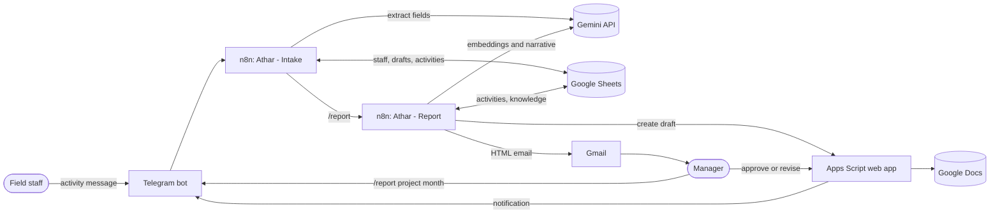

| Intake workflow (19 nodes) | Report workflow (19 nodes) |
|---|---|
| 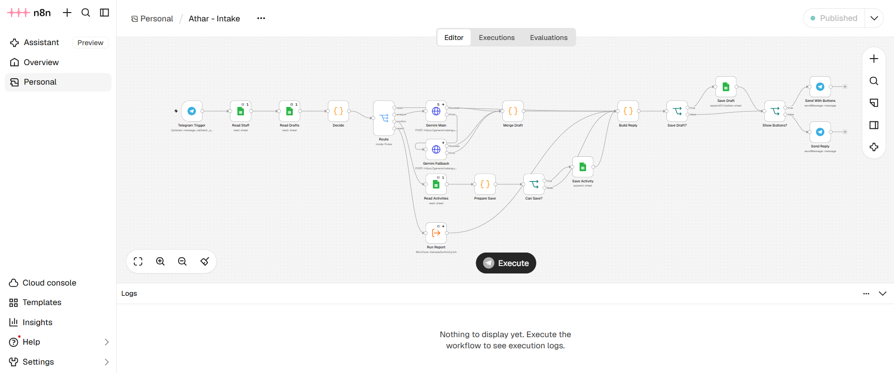 | 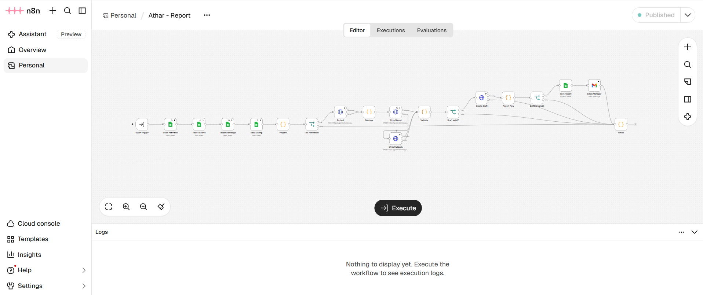 |

**Recording an activity**

| Asks for what is missing | Summary before saving |
|---|---|
| 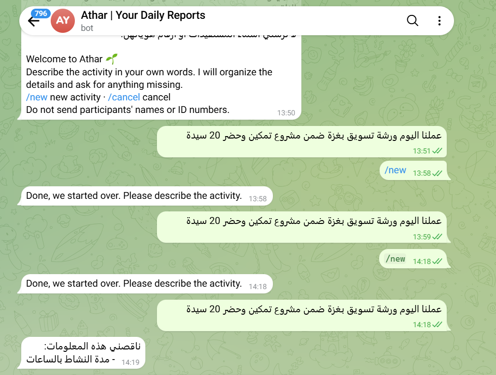 | 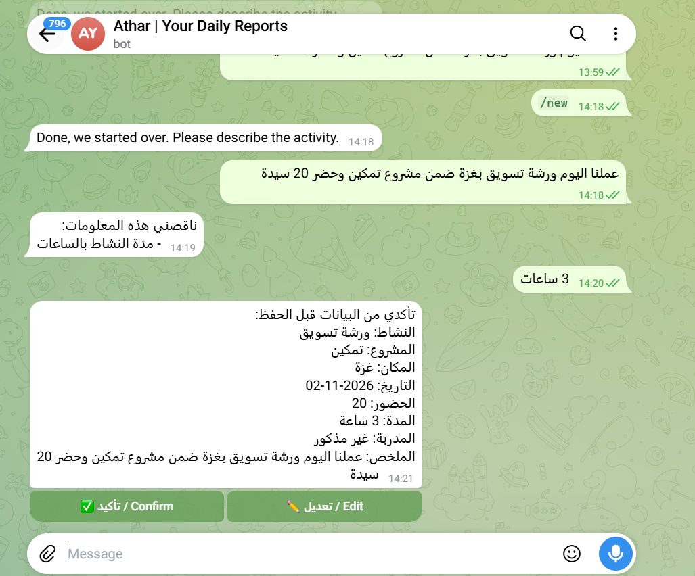 |

**Preparing and approving a report**

| Approval email | Approval page |
|---|---|
| 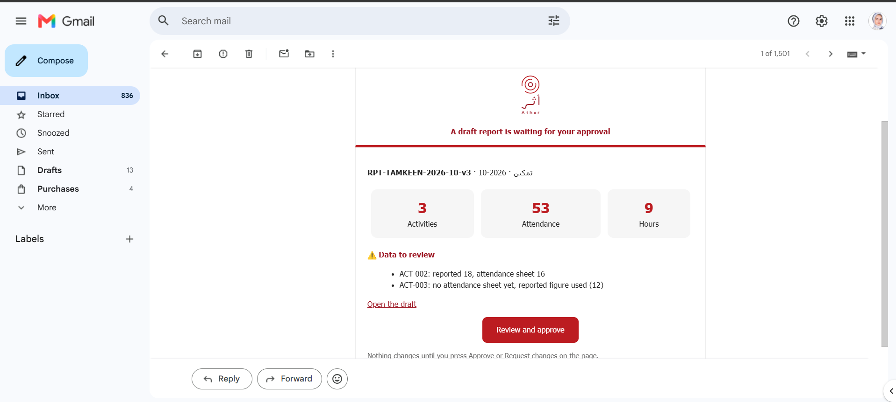 | 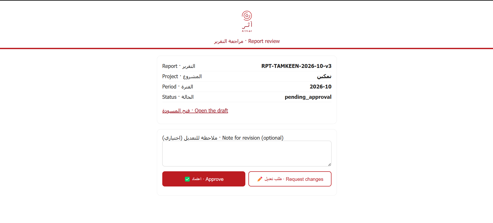 |

| Draft report (Arabic) | Version 2 applies the manager's note |
|---|---|
| 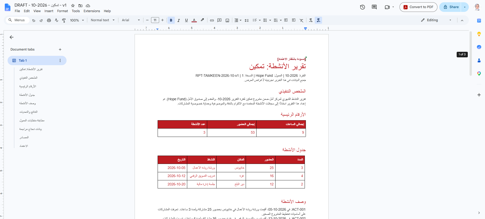 | 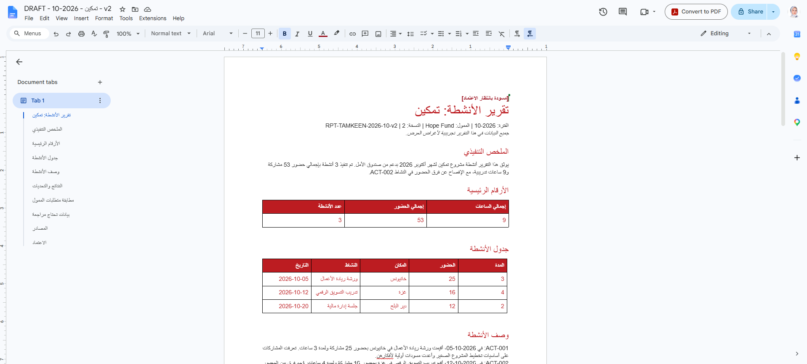 |

---

## 🛠️ Tools & Technologies

| Tool | Purpose |
|---|---|
| Telegram Bot API | Entry point for staff and the manager, buttons, notifications |
| n8n | Two workflows: Intake and Report |
| Google Gemini | Field extraction, embeddings for RAG, report narrative, with a fallback model |
| Google Sheets | Source of truth: staff, activities, attendance, reports, knowledge, audit log |
| Google Apps Script | Attendance cleaning, branded Google Docs, approval web app |
| Gmail | HTML approval email |
| Node.js tests | 12 unit tests for the logic inside the Code nodes |

---

## 🧪 Testing

22 tests were run on the live system on 2 November 2026. Selected results:

| Category | Input | Result | Status |
|---|---|---|---|
| Normal | Arabic activity without a duration | Asked only for the duration, then saved after Confirm | ✅ |
| Missing data | `عملنا ورشة بكرة` | Future date rejected, five missing fields listed | ✅ |
| Invalid input / privacy | Message with a name and an ID number | Blocked before AI, nothing saved | ✅ |
| Duplicate | The same activity again | `already recorded as ACT-005` | ✅ |
| Duplicate | Confirm pressed twice | Saved once only | ✅ |
| Permissions | Message from an unregistered user | Refused | ✅ |
| AI output | `/report تمكين 2026-10` | 3 activities, 53 attendance, 9 hours, matching the sheet | ✅ |
| Human review | Request changes with a note | v2 applied the note | ✅ |
| Security | Reuse an approval link | Locked after the decision | ✅ |
| External failure | Gemini did not respond | Hung at first. Fixed with direct API calls, time limits, and a fallback model | ⚠️ Fixed |

| Privacy guard | Duplicate rejected | Approval link locked |
|---|---|---|
| 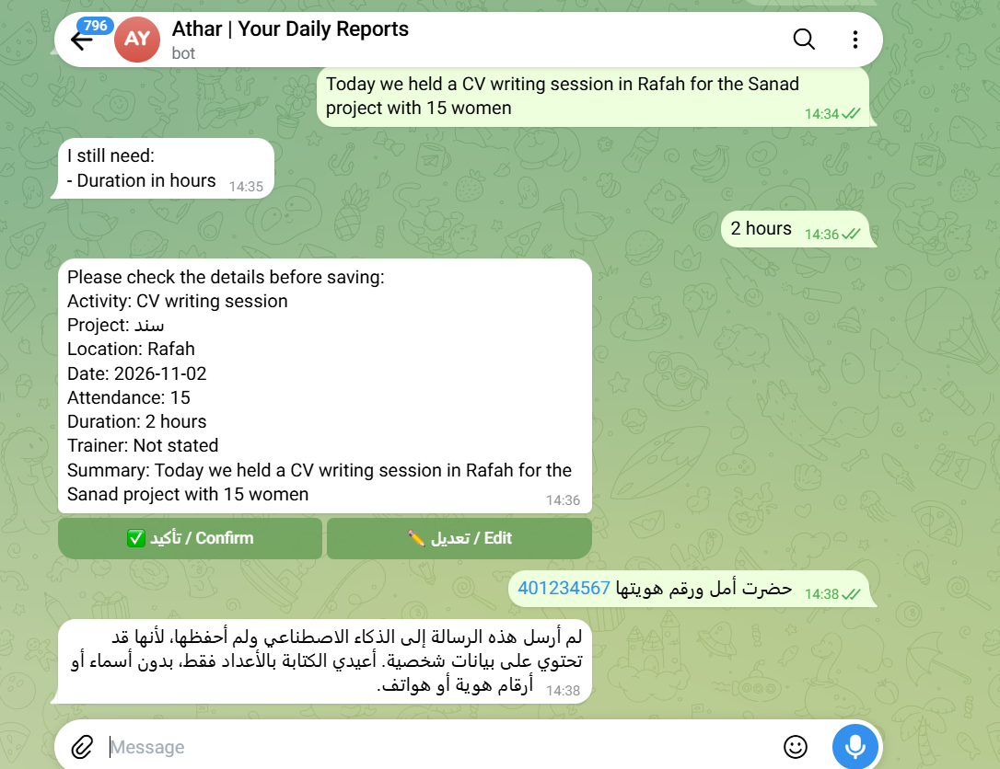 | 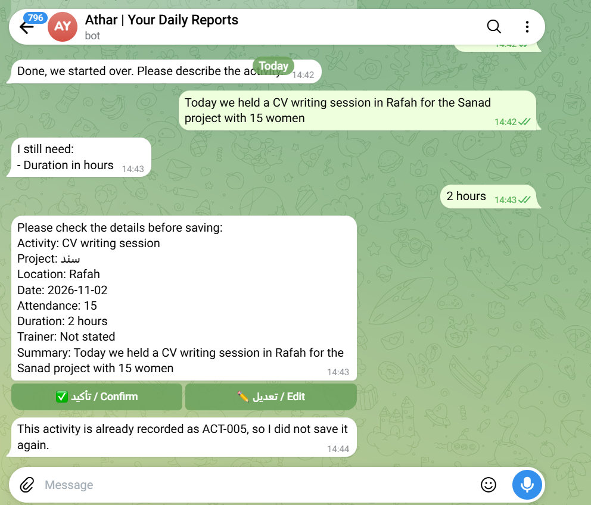 | 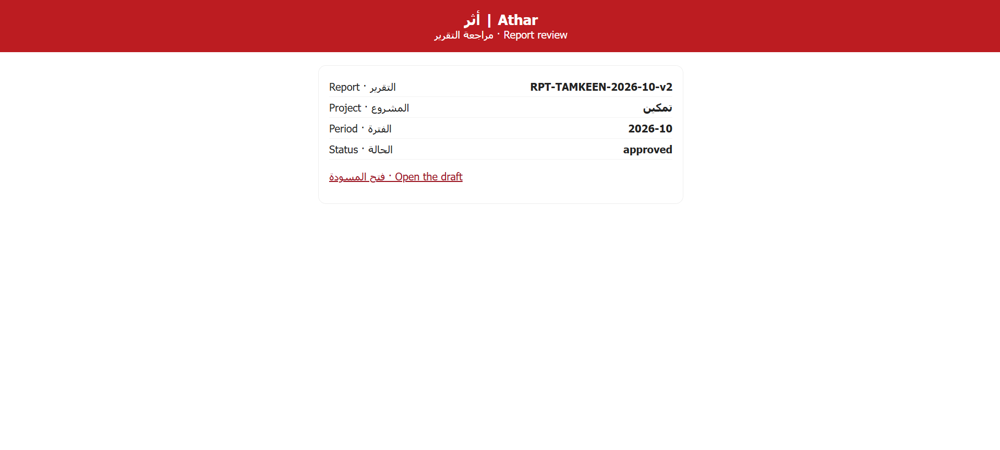 |

The full test table, with all 22 tests and evidence, is in the [project repository](https://github.com/Dina-Albaghdadi/Athar#8-testing--validation).

---

## 🚀 Deployment & Handover

| Question | Answer |
|---|---|
| Where do the workflows run? | n8n Cloud |
| Where is the data? | Google Sheets, with reports in Google Drive |
| Where does the approval page run? | Apps Script web app, deployed from the sheet |
| How are connections set up? | n8n credentials for Telegram, Google, Gemini, and Gmail. The Telegram token for notifications is in Script Properties |
| External services | Telegram and Google Workspace (free), Gemini API (free tier), and an n8n Cloud plan |
| How are failures detected? | n8n execution log, the AuditLog tab, and clear Telegram messages when a step fails |
| Setup and usage | Step-by-step in the [repository README](https://github.com/Dina-Albaghdadi/Athar#7-setup--usage) |
| Support limits | Fictional data only. Production use needs Google sign-in on the approval page and a measured pilot |

---

## 🔗 Project Links

**Live demo:** Telegram bot (private), shown in the final presentation

**Workflows:** [athar-intake.json](./workflow/athar-intake.json) · [athar-report.json](./workflow/athar-report.json) (no credentials or sheet IDs)

**Repository:** [Dina-Albaghdadi/Athar](https://github.com/Dina-Albaghdadi/Athar)

---

## 📌 What I Learned

- Choose the architecture from the problem: an agent was not needed.
- Keep numbers out of AI. Code calculates, and a validator checks every number in the AI text.
- Put a person at every decision point: confirmation before saving, approval before a report is final.
- Test failure, not only success: the most important fix came from a test where Gemini did not respond.

---

## 👩‍💻 Author

**Dina Albaghdadi**

[LinkedIn](https://www.linkedin.com/in/dina-albaghdadi-79bb9a25a/) · [GitHub](https://github.com/Dina-Albaghdadi)

---
---

## 🌍 النسخة العربية

> **أثر** نظام يعتمد على الذكاء الاصطناعي لمؤسسات المرأة. تكتب الموظفة الميدانية النشاط على تيليجرام بكلماتها، فيسأل أثر عن الناقص ولا يحفظ إلا بعد التأكيد. وفي آخر الشهر تطلب المديرة التقرير: الكود يحسب الأرقام، وRAG يسترجع متطلبات الممول، والذكاء الاصطناعي يكتب، والمديرة تعتمد أو تطلب تعديلًا من الإيميل.

> **جميع البيانات تجريبية.**

**المبدأ: الذكاء الاصطناعي يكتب، والكود يحسب، والإنسان يعتمد.**

### 🎯 المشكلة

بيانات الأنشطة مبعثرة بين الرسائل وأوراق الحضور والصور، وتُجمع يدويًا في آخر الشهر، والأرقام لا تتطابق دائمًا، ولكل ممول صيغته.

### 🧠 لماذا Workflow وليس Agent

الخطوات معروفة مسبقًا، والأرقام تذهب للممول، فلا نعطي الذكاء الاصطناعي حرية أن يقرر ماذا يحفظ أو يرسل. استخدمنا الذكاء الاصطناعي فقط حيث نحتاج فهم اللغة، وRAG لمتطلبات الممول، والكود للأرقام.

### 🧪 الاختبارات

22 اختبارًا على النظام الحقيقي: الحالة الطبيعية، والبيانات الناقصة، والتاريخ المستقبلي، وحجب البيانات الشخصية، والتكرار، والصلاحيات، وتطبيق ملاحظة المديرة في النسخة الثانية، وقفل رابط الاعتماد، وفشل Gemini الذي أُصلح بحدود زمنية ونموذج احتياطي. بالإضافة إلى 12 اختبار وحدة للكود.

### 🚀 التشغيل والتسليم

الـWorkflows على n8n Cloud، والبيانات في Google Sheets، وصفحة الاعتماد على Apps Script. خطوات الإعداد والاستخدام كاملة في [مستودع المشروع](https://github.com/Dina-Albaghdadi/Athar).

### 📌 ماذا تعلمت

اختيار المعمارية من المشكلة لا من الأداة، وإبعاد الأرقام عن الذكاء الاصطناعي، ووضع الإنسان عند كل قرار، واختبار حالات الفشل لا النجاح فقط.

